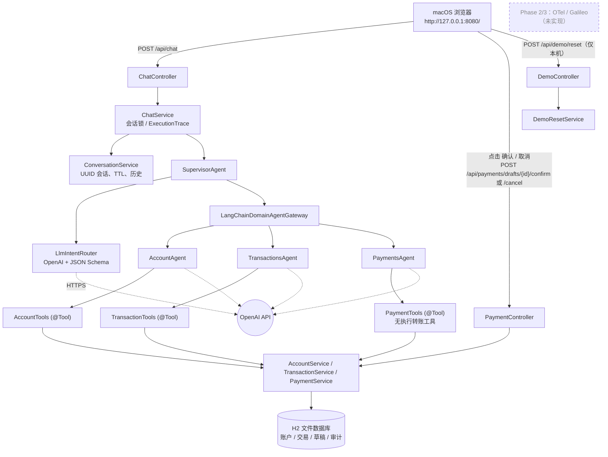
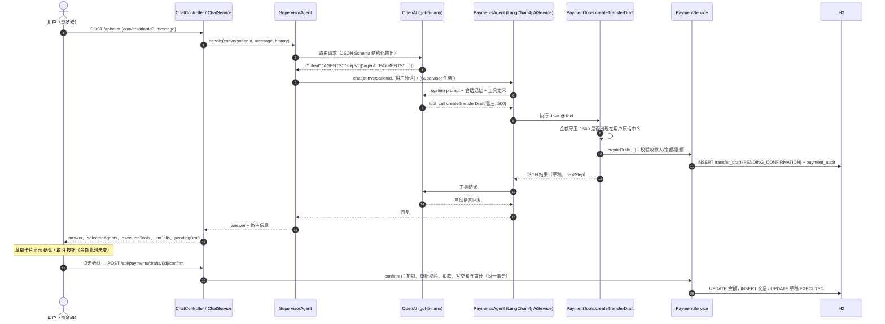
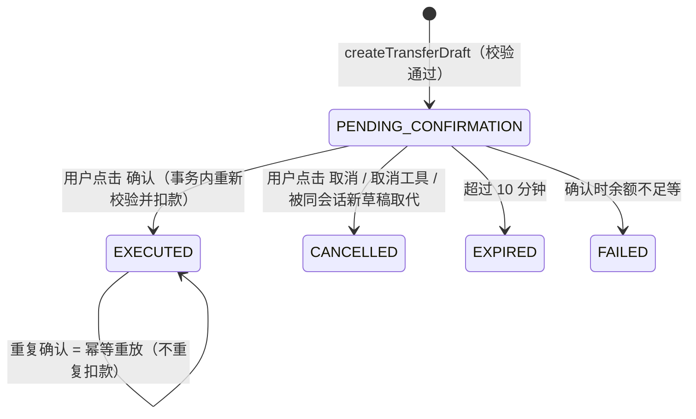

# Banking AI Agent (Java) — macOS Local Demo

> **DEMO ACCOUNT · Demo / Simulated Banking**：本项目中的客户、账户、交易与收款人全部为虚构数据，所有"转账"只是本地 H2 数据库中的模拟记账，不连接任何真实银行系统。

## 1. 项目目标与适用场景

`bank-agent-java` 是一个在 macOS 本机单进程运行的**多 Agent 银行助理演示应用**，用于：

- 演示一个真实可运行的 Java AI Agent：Supervisor 通过 OpenAI 模型理解意图并动态路由，三个领域 Agent（Account / Transactions / Payments）通过 LangChain4j **真实 Tool Calling** 调用 Java 业务服务读取/写入 H2 模拟银行数据库；
- 演示金融场景中"LLM 只能准备、人工点击才能执行"的安全模式：转账先生成草稿，只有用户在 UI 上点击 **确认** 才由后端执行；
- 作为后续阶段（Phase 2：Galileo / OpenTelemetry 插桩；Phase 3：Galileo 评估与客户演示）的**独立、已验证的业务基线**。本阶段**没有**任何 OTel / Galileo 依赖或发送逻辑。

适用场景：本机技术演示、Agent 架构讲解、后续可观测性/评估接入的基线。**不适用于生产环境**（见第 12 节）。

## 2. 技术栈与运行环境

| 类别 | 实际采用 | 说明 |
|---|---|---|
| 操作系统 | macOS（Apple Silicon 实测） | 仅本机 `127.0.0.1` 访问 |
| JDK | Java 21（本机已有 Temurin 21，SDKMAN 安装） | 脚本仅在**自身进程内**选用 Java 21，不修改系统默认 JDK |
| 构建 | Maven Wrapper（Maven 3.9.16） | 无需预装 Maven；首次构建会下载依赖到 `~/.m2` |
| 应用框架 | Spring Boot 3.5.16（Spring Framework 6.2.19） | Web MVC、Data JPA、Validation、Thymeleaf、Actuator |
| AI 框架 | LangChain4j 1.23.0（`langchain4j`、`langchain4j-open-ai`） | AiServices、`@Tool`、ChatMemory、JSON Schema 结构化输出 |
| LLM | OpenAI 官方 API，默认模型 **`gpt-5-nano`**（实测返回 `gpt-5-nano-2025-08-07`） | 低成本默认值；可通过私有配置切换 |
| 数据库 | H2 2.3.232（文件模式） | 默认位于 `~/.local/share/bank-agent-java/h2/`（OneDrive 同步目录之外） |
| 前端 | Thymeleaf 单页 + 原生 JS/CSS | 无 Node / npm 依赖 |
| 测试 | JUnit 5、AssertJ、Spring Boot Test、MockMvc | 全部离线；集成测试使用脚本化的 Stub 模型 |

运行时唯一的外部网络依赖是 OpenAI API（构建时另需 Maven Central）。不需要 Docker、Python、Node 或 Kubernetes。

## 3. 系统整体架构



**一次真实请求的端到端时序**（以"向张三转账 500 元"为例）：



## 4. Agent 结构与工作原理

所有 Agent 共用一个 `ChatModel`（`llm/LlmConfig.java`），每个领域 Agent 都是独立的 LangChain4j `AiServices` 接口，拥有**按 conversationId 隔离的独立记忆**与独立的工具集（`agent/AgentConfig.java`）。

### 4.1 Supervisor Agent

- 关键代码：`agent/SupervisorAgent.java`、`agent/LlmIntentRouter.java`、`agent/RoutingDecision.java`、`agent/AgentPrompts.java`（`supervisorPrompt`）。
- **路由由 OpenAI 模型完成**，不是关键词匹配：`LlmIntentRouter` 把最近 8 轮会话历史 + 最新用户消息发给模型，并使用 **JSON Schema 严格结构化输出**（`intent ∈ {AGENTS, CLARIFY, OUT_OF_SCOPE, SMALL_TALK}`，`steps[{agent ∈ {ACCOUNT, TRANSACTIONS, PAYMENTS}, task}]`）。
- Java 侧再做确定性校验与兜底：无效 JSON / 未知 Agent / 空任务 → `CLARIFY`（`fallback=true`）；步骤数上限 `max-route-steps=3`；**同一 Agent 只执行第一个步骤**（防止模型重复派发造成重复草稿）。
- 跨领域问题（如"余额和最近五笔交易"）按步骤**顺序委派**，再由 Java 以 `**账户信息** / **交易记录** / **转账服务**` 分节确定性地合并答复。
- 委派输入的组合方式（防止 LLM 篡改用户意图）：
  - 单 Agent 回合：`[User message - authoritative]` 用户原话 + `[Supervisor note]` 路由任务；
  - 多 Agent 回合：只给每个 Agent `[Your part ...]` 它负责的那部分任务，避免 Agent 越界回答。
- `CLARIFY` / `OUT_OF_SCOPE` / `SMALL_TALK` 不调用任何领域 Agent。

### 4.2 Account Agent

- 关键代码：`agent/AccountAgent.java`、`tool/AccountTools.java`、`service/AccountService.java`。
- 工具：`getAccountBalance`（活期/储蓄/全部）、`getAccountSummary`（脱敏概况、总余额、收款人数）、`listBeneficiaries`、`listPaymentMethods`。
- 账号一律以 `DEMO-****-0001` 形式脱敏返回。

### 4.3 Transactions Agent

- 关键代码：`agent/TransactionsAgent.java`、`tool/TransactionTools.java`、`service/TransactionService.java`、`service/Period.java`。
- 工具：`listRecentTransactions`（最近 N 笔，上限 50，按时间倒序）、`searchTransactions`（日期、收/支、类别、商户关键字、金额区间）、`summarizeSpending`（`THIS_MONTH` / `LAST_MONTH` / `LAST_7_DAYS` / `LAST_30_DAYS` / `LAST_90_DAYS` / `CUSTOM`）。
- **所有金额计算由 Java（`BigDecimal`）完成**：分类合计、占比、Top 类别、收入合计；默认不把"转账"计入消费并单独返回被排除的转账金额。LLM 只负责解释结果。

### 4.4 Payments Agent

- 关键代码：`agent/PaymentsAgent.java`、`tool/PaymentTools.java`、`service/PaymentService.java`、`service/AmountMentions.java`。
- 工具：`listTransferBeneficiaries`、`validateTransfer`、`createTransferDraft`、`cancelPendingTransfer`、`getRecentTransferActivity`（用于解释最近失败/拒绝的原因）。
- **没有任何"执行转账"的 `@Tool`**。`PaymentService.confirm()` 只被 `PaymentController` 在用户点击 UI **确认** 按钮时调用。
- 金额守卫（确定性 Java 校验）：`createTransferDraft` 的金额必须**出现在用户本轮原话中**（支持 `500`、`1,200.50`、`1.5万`、`三百`、`两千五百` 等写法）。模型自行"推断"或编造的金额会被拒绝并写入审计（代码 `AMOUNT_NOT_STATED_BY_USER`），不会生成草稿。

### 4.5 OpenAI 调用、Tool Calling 与多轮对话

- `OpenAiChatModel`（LangChain4j）直接调用 `https://api.openai.com/v1`；`store=false`；GPT-5 系列不发送 temperature，使用 `reasoning_effort=low`；`max_completion_tokens=4096`；超时 90 s、重试 1 次。
- Tool Calling 由模型决定何时调用：LangChain4j 将 `@Tool` 方法转换为 OpenAI tools 定义，执行 Java 方法后把 JSON 结果回传模型生成最终回答；单回合最多 6 次顺序工具调用（`max-tool-invocations`），防止循环调用产生费用。
- 多轮对话：
  - 每个会话有服务端生成的 UUID；`ConversationService` 保存会话历史（TTL 2 小时、最多 500 个会话），同一会话请求串行处理（并发时返回 `CONVERSATION_BUSY`）。
  - Supervisor 读取最近 8 轮历史；每个领域 Agent 有 `MessageWindowChatMemory`（20 条），以 conversationId 为 key，跨会话完全隔离。
  - UI 中的确认/取消结果会以系统备注写入会话历史，使"刚才那笔转账为什么失败"这类追问可以被正确解释。
  - 未知或已过期的 conversationId 会自动开启新会话（返回 `newConversation=true`）。
- 每次回合的**真实执行记录**（`trace/ExecutionTrace.java` + `llm/TraceChatModelListener.java`）：路由结果、每个 Agent 步骤耗时、每次工具调用（参数经脱敏）、每次 LLM 调用的模型名与 token 用量、草稿事件。这些数据随 `/api/chat` 响应返回，并显示在 UI 的"执行详情"面板中。
- 默认关闭请求/响应全文日志；日志中的 `sk-...` 与 `Bearer ...` 会被 `SecretMasker` 遮蔽。

### 4.6 模拟银行数据库与人工确认安全机制

数据表（`src/main/resources/db/schema.sql`）：`demo_customer`、`bank_account`、`beneficiary`、`bank_transaction`、`transfer_draft`、`payment_audit`。

转账状态机：



安全规则：

- 收款人白名单（仅 3 名已登记收款人）、金额 > 0 且最多 2 位小数、单笔上限 50,000.00 CNY、余额充足、只能从活期账户转出；
- 随机 UUID `draftId`，草稿绑定 conversationId 与客户；跨会话确认/取消返回 `403 DRAFT_CONVERSATION_MISMATCH` 并审计；
- 确认时使用悲观锁（`SELECT ... FOR UPDATE`）并在同一事务中重新校验、扣款、写交易流水（`reference=draftId`）、更新草稿与审计；
- 重复确认 → `replayed=true`，不重复扣款；取消后确认 → `409 DRAFT_CANCELLED`；已执行草稿取消 → `409 DRAFT_ALREADY_EXECUTED`；过期 → `409 DRAFT_EXPIRED`；
- 自然语言"确认"不会执行转账：Payments Agent 没有执行工具，提示词也要求引导用户点击按钮；
- 所有拒绝、取代、过期、确认、重放都写入 `payment_audit`。

## 5. 源代码目录与关键 Java 类

```text
bank-agent-java/
├── README.md                         本文档
├── pom.xml / mvnw / mvnw.cmd / .mvn/ Maven Wrapper 构建
├── config/                           不含密钥的配置模板
│   ├── application-secrets.example.properties
│   └── galileo.example.properties     Phase 2 观测后端配置模板（Splunk AO SaaS 或 Galileo，每种后端只填 1–2 项）
├── docs/
│   ├── CONFIG-MAPPING.md             配置键映射、来源与推导规则（不含值）
│   └── PHASE1-VALIDATION.md          Phase 1 验收记录
├── scripts/                          preflight / run / stop / test / reset-demo（lib/common.sh 公共函数）
└── src/
    ├── main/java/com/demo/bankagent/
    │   ├── BankAgentApplication.java
    │   ├── api/            ChatController, PaymentController, DemoController, StatusController,
    │   │                   UiController, GlobalExceptionHandler, ApiError, ApiRequests
    │   ├── agent/          SupervisorAgent, LlmIntentRouter, IntentRouter, RoutingDecision, AgentType,
    │   │                   AccountAgent, TransactionsAgent, PaymentsAgent, AgentConfig, AgentPrompts,
    │   │                   LangChainDomainAgentGateway, DomainAgentGateway, AgentMemoryStores, AgentMemoryManager
    │   ├── tool/           AccountTools, TransactionTools, PaymentTools, ToolSupport
    │   ├── service/        AccountService, TransactionService, PaymentService, DemoDataService,
    │   │                   DemoResetService, AmountParser, AmountMentions, Period, Views, ErrorCode ...
    │   ├── llm/            LlmConfig, TraceChatModelListener, LlmErrorTranslator, SecretMasker, UnconfiguredChatModel
    │   ├── trace/          ExecutionTrace 及 Agent/Tool/LLM/草稿事件记录（Phase 2 插桩的自然切入点）
    │   ├── conversation/   ChatService, ConversationService, Conversation
    │   ├── domain/         JPA 实体与枚举
    │   ├── repository/     Spring Data JPA 仓库
    │   └── config/         BankAgentProperties, ClockConfig
    ├── main/resources/     application.yml, db/schema.sql, templates/index.html, static/{css,js}
    └── test/java/...       单元测试（*Test）与集成测试（*IT），support/ 下为测试替身
```

清晰的边界（`IntentRouter`、`DomainAgentGateway`、`@Tool` 类、`ChatModelListener`、`ExecutionTrace`）便于 Phase 2 在 Supervisor / Agent / Tool / LLM 调用点插入 Span，本阶段**不实现** Span。

## 6. macOS 安装与本地配置

### 6.1 JDK 21 与 Maven Wrapper

本机已有 Java 21（Temurin 21，由 SDKMAN 安装在 `~/.sdkman/candidates/java/21-tem`）。注意：在本机上 `/usr/libexec/java_home -v 21` **找不到**该 JDK（它不在 `/Library/Java/JavaVirtualMachines`），因此脚本按以下顺序选择 Java 21，且只 `export` 到**脚本自身进程**：

1. 当前 `JAVA_HOME`（若为 21）；
2. `/usr/libexec/java_home -v 21`；
3. `~/.sdkman/candidates/java/21*`；
4. `PATH` 中的 `java`（若为 21）。

脚本不会执行 `sdk default`、不会修改 `~/.zshrc`、不会安装或替换任何 JDK，对本机其他 Java 应用没有影响。Maven 由 Wrapper 自动下载（`./mvnw`），无需安装。

```bash
cd /Users/hangwe/Library/CloudStorage/OneDrive-Cisco/dev/bank-agent-java
java -version            # 确认仍为 21
scripts/preflight.sh     # 检查 macOS、Java 21、Wrapper、端口、私有配置是否就绪（不打印密钥）
```

### 6.2 安全复用 Golden Demo Credentials

- 只读审阅了 `splunk-ao-golden-demo` 的 `.streamlit/secrets.toml`、`domains/bank/config.yaml` 和 `setup_env.py`，**未修改原项目**。
- 原项目 `openai_api_key` 属于 **OpenAI 官方 API**（已用真实调用验证），被复制到本机私有文件。Phase 2 的观测后端默认改为 Splunk Observability Cloud 集成的 Splunk AO SaaS，其配置不再从 Golden Demo 复制；如需改用 Golden Demo 所用的 Galileo 多租户云或传统的 `app.galileo.ai`，按 `galileo.properties` 第 1 组注释切换即可（见第 13 节与 `docs/CONFIG-MAPPING.md`）：

  ```text
  ~/.config/bank-agent-java/application-secrets.properties   (目录 0700，文件 0600，OpenAI 配置)
  ~/.config/bank-agent-java/galileo.properties               (0600，Phase 2 的观测后端 / Agent Control 配置)
  ```

- 两个文件都在仓库与 OneDrive 同步目录**之外**。应用通过 `spring.config.import=optional:file:${BANK_AGENT_SECRETS_FILE}` 读取第一个文件；**Phase 1 代码不读取 `galileo.properties`**。
- 仓库只包含模板 `config/*.example.properties` 与键名映射 `docs/CONFIG-MAPPING.md`；`.gitignore` 忽略 `.env*`、`*secrets*`（模板除外）、`config/*.properties`（模板除外）、日志与数据库文件。
- 在另一台机器上从零配置：

  ```bash
  mkdir -p ~/.config/bank-agent-java && chmod 700 ~/.config/bank-agent-java
  cp config/application-secrets.example.properties ~/.config/bank-agent-java/application-secrets.properties
  chmod 600 ~/.config/bank-agent-java/application-secrets.properties
  # 用编辑器填入 OPENAI_API_KEY（不要在终端 echo 密钥）
  open -e ~/.config/bank-agent-java/application-secrets.properties

  # Phase 2 用：按文件第 1 组注释为一种后端填写凭据（默认 Splunk AO SaaS：AO_REALM、AO_O11Y_TOKEN），其余键留空即自动推导
  cp config/galileo.example.properties ~/.config/bank-agent-java/galileo.properties
  chmod 600 ~/.config/bank-agent-java/galileo.properties
  open -e ~/.config/bank-agent-java/galileo.properties
  ```

### 6.3 OpenAI 模型与 API 配置

| 键 | 默认值 | 说明 |
|---|---|---|
| `OPENAI_API_KEY` | （无） | 仅放私有文件或环境变量。缺失时应用仍能启动，但聊天返回 `503 LLM_NOT_CONFIGURED` |
| `OPENAI_MODEL` | `gpt-5-nano` | 低成本默认模型，已实测支持 Tool Calling 与 JSON Schema |
| `OPENAI_BASE_URL` | `https://api.openai.com/v1` | 默认 OpenAI 官方端点 |
| `OPENAI_REASONING_EFFORT` | `low` | GPT-5 系列推理强度；切换到非推理模型（如 `gpt-4.1-mini`）时设为空值 |
| `OPENAI_MAX_COMPLETION_TOKENS` | `4096` | 单次输出上限（含推理 token） |
| `OPENAI_TIMEOUT` / `OPENAI_MAX_RETRIES` | `90s` / `1` | 超时与重试 |

**切换模型**：编辑私有文件中的 `OPENAI_MODEL`（必要时同时调整 `OPENAI_REASONING_EFFORT`），然后重启应用即可，无需修改代码。同名环境变量优先于私有文件，例如临时试用：

```bash
OPENAI_MODEL=gpt-5-mini scripts/run.sh
```

为什么选 `gpt-5-nano`：用户要求控制费用；实测它能稳定完成结构化路由与工具调用。代价是单回合 4–10 秒、回答偶尔偏冗长；Java 侧的确定性校验（金额守卫、去重、白名单、确认按钮）保证即使模型出错也不会产生未授权的资金变动。

成本控制：每回合通常 3 次 LLM 调用（路由 + 工具调用 + 最终回答，跨 Agent 回合 5 次），约 2k–8k 输入 token；限制了工具调用次数（6）、Agent 记忆（20 条）、路由历史（8 轮）、消息长度（1000 字符）与最大输出 token。

### 6.4 启动、停止与健康检查

```bash
cd /Users/hangwe/Library/CloudStorage/OneDrive-Cisco/dev/bank-agent-java

scripts/run.sh                 # 前台启动（Ctrl+C 停止）；源码有变更时自动重新打包
scripts/run.sh --background    # 后台启动，等待健康检查通过；日志 ~/.local/share/bank-agent-java/logs/bank-agent.log
scripts/run.sh --rebuild       # 强制重新打包后启动
scripts/stop.sh                # 停止后台实例

curl -s http://127.0.0.1:8080/actuator/health    # {"status":"UP"}
curl -s http://127.0.0.1:8080/api/status         # 模型名、是否已配置密钥（布尔值）、限额等，不含密钥
open http://127.0.0.1:8080/
```

可选环境变量：`BANK_AGENT_PORT`（默认 8080）、`BANK_AGENT_HOST`（默认 127.0.0.1）、`BANK_AGENT_DATA_DIR`（默认 `~/.local/share/bank-agent-java`）、`BANK_AGENT_SECRETS_FILE`、`BANK_AGENT_TRUSTSTORE`（见 11 节）。

### 6.5 如何临时切换 JDK 及恢复到 JDK 21（仅必要时）

本项目**不需要**切换 JDK。若因其他工作需要临时使用别的 JDK，只在当前终端生效：

```bash
sdk list java                       # 查看已安装版本
sdk use java <other-version>        # 仅当前终端会话生效
sdk use java 21-tem                 # 恢复到 JDK 21（或直接关闭该终端）
java -version
```

不要使用 `sdk default ...`（会修改全局默认）。即使当前终端是别的 JDK，`scripts/*.sh` 也会在自身进程中重新选择 Java 21；若当前 `JAVA_HOME` 不是 21，会自动回退到 SDKMAN 的 21。

## 7. Web UI 和 HTTP API 使用方法

**Web UI**（`http://127.0.0.1:8080/`）：

- 顶部显示 `DEMO ACCOUNT`、`Demo / Simulated Banking` 与当前模型名；
- 左侧：演示账户余额、已登记收款人、单笔上限、**示例问题**（点击即可填入）、**新建会话**、**重置演示数据**；
- 中间：会话消息、"助理正在处理…"等待指示；当 Payments Agent 生成草稿时出现**转账草稿卡片**，含 **确认** / **取消** 按钮与有效期；
- 右侧：**执行详情**（来自后端真实执行记录）——路由意图、选中的 Agent、每个 Tool 调用及耗时、LLM 调用次数与 token、草稿事件。

**HTTP API**：

| 方法与路径 | 请求体 | 说明 |
|---|---|---|
| `POST /api/chat` | `{"conversationId"?: "...", "message": "..."}` | 返回 `conversationId`、`newConversation`、`messageId`、`answer`、`intent`、`selectedAgents`、`executedTools`、`agentSteps`、`toolCalls`、`llmCalls`、`pendingDraft`、`draftEvents`、`durationMs`、`model` |
| `POST /api/payments/drafts/{draftId}/confirm` | `{"conversationId": "..."}` | 用户点击确认后执行；重复确认返回 `replayed=true` |
| `POST /api/payments/drafts/{draftId}/cancel` | `{"conversationId": "..."}` | 取消待确认草稿 |
| `POST /api/demo/reset` | 无 | 仅 loopback 地址可调用，否则 `403 LOCAL_ACCESS_ONLY` |
| `GET /api/demo/profile` | — | 脱敏账户概况与收款人（UI 左侧栏） |
| `GET /api/status` | — | 应用/模型状态，不含密钥 |
| `GET /actuator/health` | — | 健康检查 |

错误统一返回 `{"code","message","status","timestamp"}`，从不包含堆栈或密钥。常见错误码：`VALIDATION_ERROR`(400)、`UNSUPPORTED_MEDIA_TYPE`(415)、`CONVERSATION_NOT_FOUND`(404，草稿操作时)、`DRAFT_NOT_FOUND`(404)、`DRAFT_CONVERSATION_MISMATCH`(403)、`DRAFT_CANCELLED` / `DRAFT_EXPIRED` / `DRAFT_ALREADY_EXECUTED` / `DRAFT_FAILED`(409)、`INSUFFICIENT_FUNDS` 等(422)、`CONVERSATION_BUSY`(409)、`LLM_NOT_CONFIGURED`(503)、`LLM_UPSTREAM_ERROR`(502)。

示例：

```bash
curl -s -X POST http://127.0.0.1:8080/api/chat -H 'Content-Type: application/json' \
  -d '{"message":"我现在的活期账户余额是多少？"}'
```

## 8. 示例银行数据与重置方法

- 演示客户：王小明（演示用户），`CUST-DEMO-001`；活期 `DEMO-****-0001` 余额 **52,368.50 CNY**，储蓄 `DEMO-****-0002` 余额 **120,000.00 CNY**；
- 已登记收款人：张三（BEN-001）、李四（BEN-002）、王五（BEN-003），银行名称均为虚构；
- 25 笔交易覆盖"上个自然月 + 本月"，类别包括住房、餐饮、工资收入、购物、交通、水电燃气、转账、娱乐、医疗、退款、通讯、利息。

**日期生成策略**（`service/DemoDataService.java`）：以应用时区 `Asia/Shanghai` 的"今天"为基准**相对生成**、固定金额：

- 上个自然月使用固定日（1–27 日，所有月份都存在），因此"上个月"的统计结果每天都一致：消费合计 **10,689.00**（不含 1,000.00 转账），最多类别 **购物 4,878.00**，收入 18,000 + 199 退款（另有储蓄利息 120）；
- 本月 8 笔交易按日 1–8 生成，但**不晚于当前时间**（例如每月 1 日凌晨启动时，会被压缩到当天已过去的时间内），保证不会出现未来交易；
- 期末余额固定，`balance_after` 按时间倒推计算；首次启动时若数据库为空才写入种子数据，重启不会叠加数据。

**重置**（恢复余额、交易，清除草稿、审计与所有会话）：

```bash
scripts/reset-demo.sh          # 应用运行中：调用本机 reset API；未运行：删除本地 H2 文件，下次启动重新生成
scripts/reset-demo.sh --yes    # 跳过确认提示
```

或点击 UI 左侧的"重置演示数据"。

## 9. Phase 1 演示问题与预期业务执行过程

建议在**同一会话**中依次提问（第 7、9 题依赖上下文）：

| # | 用户问题 | Supervisor 路由 | 实际调用的 Java Tool | 预期业务结果 |
|---|---|---|---|---|
| 1 | 我现在的活期账户余额是多少？ | ACCOUNT | `getAccountBalance` | 52,368.50 CNY |
| 2 | 列出我最近的五笔交易。 | TRANSACTIONS | `listRecentTransactions(limit=5)` | 按时间倒序的 5 笔本月交易 |
| 3 | 上个月我在哪类消费上花钱最多？一共花了多少？ | TRANSACTIONS | `summarizeSpending(LAST_MONTH)` | 购物 4,878.00；合计 10,689.00（不含转账） |
| 4 | 把我的账户余额和最近五笔交易一起告诉我。 | ACCOUNT + TRANSACTIONS | `getAccountBalance` + `listRecentTransactions` | 两段式答复（账户信息 / 交易记录） |
| 5 | 向张三转账 500 元。 | PAYMENTS | `createTransferDraft` | 生成待确认草稿，**余额不变**，UI 出现确认卡片 |
| 6 | 取消刚才的转账。 | PAYMENTS | `cancelPendingTransfer` | 草稿 CANCELLED，未扣款 |
| 7 | 再给他转 300 元。 | PAYMENTS | `createTransferDraft(张三, 300)` | 依据上下文识别"他"=张三，生成新草稿；点击**确认**后余额变为 52,068.50 |
| 8 | 向一个未登记的陌生收款人转账 999999 元。 | PAYMENTS | `createTransferDraft` → 拒绝 | 不生成草稿；原因：收款人未登记、超过单笔上限、余额不足；写入审计 |
| 9 | 这笔转账失败的原因是什么？ | PAYMENTS | `getRecentTransferActivity` | 基于审计记录解释上一题的拒绝原因，不创建新草稿 |

附加演示：再次点击已执行草稿的"确认" → 提示已执行、不重复扣款；说"按刚才那个金额再给李四转一次" → 若模型自行补出金额，会被金额守卫拒绝（`AMOUNT_NOT_STATED_BY_USER`）。

## 10. 自动化测试与实际验收结果

```bash
scripts/test.sh        # 等价于 ./mvnw -B clean verify（项目内选择 Java 21）
```

测试完全离线：Surefire/Failsafe 强制 `OPENAI_API_KEY` 为空、私有配置路径指向不存在的文件；集成测试使用内存 H2、固定时钟（2026-03-15 10:00）和脚本化的 `ScriptedChatModel`（真实走 LangChain4j AiServices 与 Java Tools，只替换 OpenAI 网络调用）。

| 测试类 | 类型 | 覆盖内容 |
|---|---|---|
| `AmountMentionsTest`、`AmountParserTest` | 单元 | 金额解析（阿拉伯/中文数字、万/千）与金额守卫 |
| `SupervisorAgentTest` | 单元 | 单域、跨域、澄清/超范围、重复步骤去重、Agent 异常、输入组合 |
| `LlmSafetyUnitTest`、`DemoControllerLoopbackTest` | 单元 | 未配置模型快速失败、密钥遮蔽、本机地址判定 |
| `LlmIntentRouterIT` | 集成 | 结构化路由、无效输出兜底、步骤上限、历史上下文 |
| `BankingServicesIT` | 集成 | 余额、最近交易排序、上月消费聚合、月初凌晨种子不产生未来交易、重置幂等 |
| `PaymentServiceIT` | 集成 | 草稿不扣款；确认后余额/交易/审计一致；重复确认；新草稿取代旧草稿；未登记收款人、非法金额、超限、余额不足（草稿时与确认时）、过期、跨会话、取消后确认、已执行不可取消；金额守卫审计 |
| `AgentFlowIT` | 集成 | 经 Supervisor → AiServices → 真实 Tool → H2 的完整回合：执行记录、跨 Agent 合并、草稿、金额守卫、同会话记忆延续与跨会话隔离、超范围问题 |
| `ApiControllersIT` | 集成 | `/api/chat` 输入校验（空、超长、坏 JSON、415）、过期会话、LLM 失败无堆栈；确认/重放/取消/409/403/404；本机重置；UI、健康检查、状态接口无密钥 |

最近一次结果：**49 个测试全部通过**（15 单元 + 34 集成），`BUILD SUCCESS`。

真实 OpenAI 在线验收（`gpt-5-nano-2025-08-07`）：第 9 节 9 个问题全部通过，并验证了 UI 确认执行、重复确认、跨会话拒绝、取消后确认、金额守卫等场景。详细记录（每题的 Agent、Tool、耗时、token、结果、首次验收发现的问题及修复）见 [`docs/PHASE1-VALIDATION.md`](docs/PHASE1-VALIDATION.md)。

## 11. 常见问题与故障排查

| 现象 | 原因与处理 |
|---|---|
| `PKIX path building failed` / `unable to find valid certification path` | 公司网络（如 Cisco Secure Access）对 HTTPS 做 TLS 检查，JDK 默认 cacerts 不信任其根证书。`scripts/run.sh` 会在 `~/.local/share/bank-agent-java/tls/truststore.p12` 生成**项目专用** truststore（JDK cacerts + macOS 钥匙串中的系统/企业根证书），只对本应用进程生效，不修改 JDK。设置 `BANK_AGENT_TRUSTSTORE=none` 可禁用，或 `BANK_AGENT_TRUSTSTORE=/path/to/store.p12` 使用自定义 truststore。**请始终用 `scripts/run.sh` 启动**，直接 `java -jar` 可能遇到此错误 |
| 聊天返回 `LLM_NOT_CONFIGURED` | 私有文件不存在或 `OPENAI_API_KEY` 为空；运行 `scripts/preflight.sh` 检查 |
| 聊天返回 `LLM_UPSTREAM_ERROR` | OpenAI 返回错误（401 密钥无效、404 模型不可用、429 限流/额度、网络中断）。查看 `~/.local/share/bank-agent-java/logs/bank-agent.log`（密钥已遮蔽） |
| `Java 21 not found` | 安装 JDK 21（如 `sdk install java 21-tem`）或设置 `JAVA_HOME` 指向 JDK 21 |
| 端口 8080 被占用 | `BANK_AGENT_PORT=8081 scripts/run.sh`，或 `scripts/stop.sh` 停止已有实例 |
| H2 `Database may be already in use` | 已有实例在运行（同一数据目录）；先 `scripts/stop.sh` |
| 回答较慢（4–10 秒）或较啰嗦 | `gpt-5-nano` 为推理模型；可改用 `OPENAI_REASONING_EFFORT=minimal` 或更换模型 |
| `CONVERSATION_BUSY` | 同一会话上一条消息尚未完成，等待后重试 |
| 余额与预期不一致 | 之前演示中执行过转账；运行 `scripts/reset-demo.sh` |
| 刚才的会话"消失" | 会话保存在内存中，重启或 2 小时无活动后过期；系统会自动开启新会话 |

## 12. 安全、限制与非生产用途声明

- **非生产用途**：单一固定演示用户，无登录/认证；所有数据虚构；转账仅为本地模拟记账。
- 服务默认只绑定 `127.0.0.1`；重置接口仅允许 loopback 地址；H2 Console 关闭；Actuator 仅暴露 `health`。
- 发送给 OpenAI 的只有模拟数据与用户在 UI 输入的文字；不发送 Golden Demo 密钥、Galileo 配置或真实个人信息。
- 密钥只存在于仓库外的 0600 私有文件中；页面、API、日志、测试和文档均不包含密钥。
- 已知限制：
  - 会话与 Agent 记忆在内存中，重启即丢失（数据库数据保留）；
  - 中文金额解析覆盖常见写法，但"一万二"这类口语省略写法会被解析为 10002，守卫会因此拒绝并要求用户写明金额（偏安全）；
  - `gpt-5-nano` 回答风格偶尔冗长；LLM 输出本身具有不确定性，安全性依赖 Java 侧的确定性校验，而非提示词；
  - 未实现多币种、多客户、定时转账、真实银行接口。

## 13. Phase 2 — Galileo OpenTelemetry Instrumentation
> 尚未实施。Phase 2 完成后将以完整说明替换本节；以下仅为已完成的配置准备（2026-11-02）。

- **私有配置**：`~/.config/bank-agent-java/galileo.properties`（`0600`），模板为 `config/galileo.example.properties`。文件第 1 组列出三种后端，用户只为其中**一种**填写凭据；Console、API、OTLP、Agent Control 的地址与认证头等键保留但留空，留空时按该后端官方文档与官方 SDK 的规则自动推导，需要时才填写覆盖。

  | 后端 | Console | 配置档 | 需填写 |
  |---|---|---|---|
  | Splunk AO SaaS（Splunk Observability Cloud，**当前默认**，本机 realm `au0`） | `https://app.<realm>.observability.splunkcloud.com/` | `o11y` | `AO_REALM`、`AO_O11Y_TOKEN`（请求头 `X-SF-Token`） |
  | Galileo SaaS（传统） | `https://app.galileo.ai/` | `galileo` | `AO_API_KEY`（请求头 `Galileo-API-Key`） |
  | Galileo 多租户云（Golden Demo 使用） | `https://console.multitenant.galileocloud.io/<tenant>` | `galileo` | `AO_API_KEY`、`AO_CONSOLE_URL=https://console.multitenant.galileocloud.io`（只填根地址，不含 `/splunkse` 等租户路径） |

- **切换后端**：填写新后端对应的键，并把 `AO_BACKEND_PROFILE` 设为 `o11y` 或 `galileo`（只填一种后端时可留空，自动判断）。其他推导键继续留空即可，Project / Agent Stream 会在新后端上自动创建。两类后端的凭据不通用。
- **Project / Agent Stream**：只配置名称（默认 `bank-agent-java` / `bank-java-demo`），不配置 ID。Phase 2 插桩在启动时通过当前后端的 REST API 按名称查找，不存在则自动创建，并获取 UUID；Agent Control 的目标 ID 就是该 Agent Stream 的 UUID，同样无需配置。
- **开关**：`OBSERVABILITY_ENABLED=false`、`CONTROL_MODE=off`，在 Phase 2 的 P0 协议验证通过前保持关闭。
- 完整键名、推导规则、来源与 Token 只读验证结果见 [`docs/CONFIG-MAPPING.md`](docs/CONFIG-MAPPING.md)。

## 14. Phase 3 — Galileo Evaluation & Customer Demo Guide
> Reserved. Not implemented in Phase 1.

## 15. Roadmap

- **Phase 1（本阶段，已完成）**：Java 21 / Spring Boot / LangChain4j 多 Agent 银行助理、真实 OpenAI Tool Calling、H2 模拟银行、人工确认转账、离线测试与在线验收。
- **Phase 2（待实施，配置已准备）**：在 Supervisor、领域 Agent、Tool、LLM 调用点增加 OpenTelemetry 插桩，并以 Java REST Adapter 集成 Agent Control；配置位于 `~/.config/bank-agent-java/galileo.properties`（见第 13 节与 `docs/CONFIG-MAPPING.md`）。OTLP 端点已按官方规则由 realm 推导并通过 Token 只读验证，真实 Span 的 Console 路由与 Control 接口仍待 Phase 2 P0 验证。
- **Phase 3（待实施）**：Galileo 评估与客户演示指南。

## 16. 参考资料与开源项目来源

- Azure-Samples，Multi-Agent Banking Assistant with Java and LangChain4j（借鉴 Supervisor / Account / Transactions / Payments 业务分工；未移植 Azure 相关组件与 React 前端）：<https://github.com/Azure-Samples/agent-openai-java-banking-assistant>
- LangChain4j — Spring Boot Integration：<https://docs.langchain4j.dev/tutorials/spring-boot-integration/>
- LangChain4j — AI Services：<https://docs.langchain4j.dev/tutorials/ai-services/>
- LangChain4j — Tools / Function Calling：<https://docs.langchain4j.dev/tutorials/tools/>
- LangChain4j — Chat Memory：<https://docs.langchain4j.dev/tutorials/chat-memory/>
- LangChain4j — OpenAI Integration：<https://docs.langchain4j.dev/integrations/language-models/open-ai/>
- Spring Boot System Requirements：<https://docs.spring.io/spring-boot/system-requirements.html>
- Splunk Agent Observability（后续阶段参考，本阶段不接入）：<https://agent-observability-docs.splunk.com/what-is-splunk-agent-observability>
