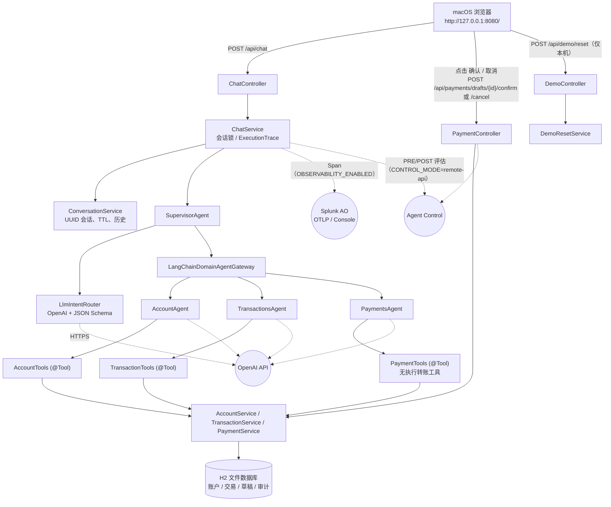
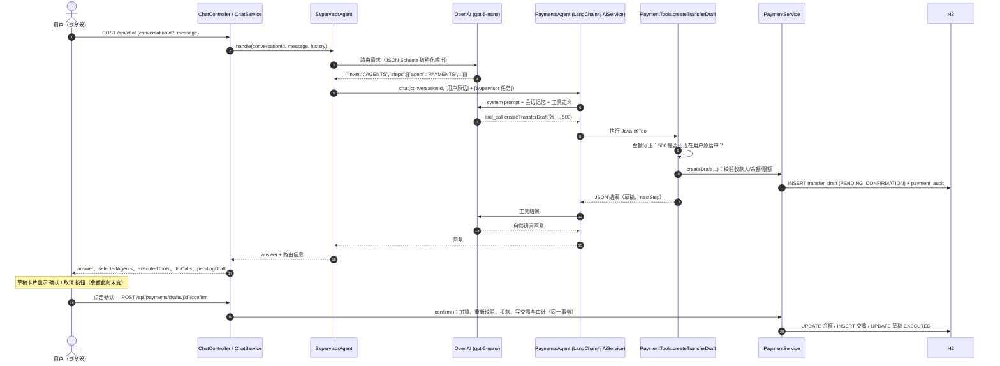
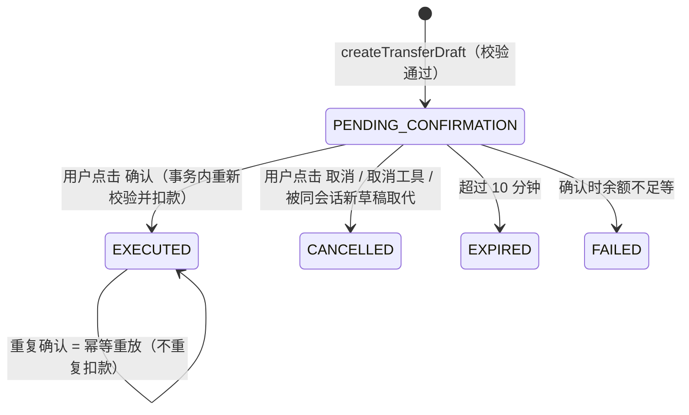

# 银行 AI 助理（Java）+ Galileo 可观测与运行时管控 — macOS 本地演示

> **DEMO ACCOUNT · Demo / Simulated Banking**：本项目中的客户、账户、交易与收款人全部为虚构数据，所有"转账"只是本地 H2 数据库中的模拟记账，不连接任何真实银行系统。

很多企业级AI Agent都采用Java开发，特别是金融领域，而Splunk Agent Observability（Galileo）官方没有提供完全基于Java和OpenTelemetry实现Instrumentation的演示，因此开发了本项目。本项目的`bank-agent-java` 是一个在 macOS 本机运行的 Java 多 Agent 银行助理，并接入了 Galileo（默认后端为 Splunk Observability Cloud 中的 Splunk AO SaaS）的可观测与运行时管控。内容分为三部分：

| 部分 | 内容 | README 章节 | 详细文档 |
|---|---|---|---|
| 银行 AI 应用 | 多 Agent 架构、OpenAI Tool Calling、模拟银行与人工确认转账、安装运行、API、测试 | 第 1–9 节 | [`docs/app/VALIDATION.md`](docs/app/VALIDATION.md)、[`docs/CONFIG-MAPPING.md`](docs/CONFIG-MAPPING.md) |
| Galileo 插桩 | OpenTelemetry 观测（Trace 发往 Splunk AO）与 Agent Control 门禁，两者可独立开关 | 第 10–13 节 | [`docs/galileo/`](docs/galileo/) |
| 演示 | 把应用与 Galileo 能力串成一条完整的故事线：操作步骤、预计现象、准备与复位 | 第 14 节 | [`docs/demo/DEMO-GUIDE.md`](docs/demo/DEMO-GUIDE.md) |
| 附录 | 常见问题、安全与限制、参考资料 | 第 15–17 节 | — |

## 快速开始

```bash
cd /Users/hangwe/Library/CloudStorage/OneDrive-Cisco/dev/bank-agent-java
scripts/preflight.sh                               # 检查 Java 21、私有配置与 Galileo 推导结果（只读，不打印密钥）
scripts/run.sh --background                        # 只运行银行 AI 应用
# 或：scripts/run.sh --background --observe --control   # 同时开启 Galileo 插桩（需先配置 galileo.properties，见第 6.2 节）
open http://127.0.0.1:8080/
scripts/stop.sh
```

## 第一部分：银行 AI 应用

### 1. 项目目标与适用场景

`bank-agent-java` 是一个在 macOS 本机单进程运行的**多 Agent 银行助理**，用于：

- 演示一个真实可运行的 Java AI Agent：Supervisor 通过 OpenAI 模型理解意图并动态路由，三个领域 Agent（Account / Transactions / Payments）通过 LangChain4j **真实 Tool Calling** 调用 Java 业务服务读取/写入 H2 模拟银行数据库；
- 演示金融场景中"LLM 只能准备、人工点击才能执行"的安全模式：转账先生成草稿，只有用户在 UI 上点击 **确认** 才由后端执行；
- 演示 Galileo 插桩（第二部分）：可独立开关的 OpenTelemetry 观测和纯 Java 的 Agent Control 门禁——Console 中定义的规则在 Java 中真实执行（PRE/POST、DENY/STEER/OBSERVE、失败模式）。两个开关默认关闭，关闭时应用的行为与没有插桩时完全一致。

适用场景：本机技术演示、Agent 架构与可观测/治理讲解。**不适用于生产环境**（见第 16 节）。

### 2. 技术栈与运行环境

| 类别 | 实际采用 | 说明 |
|---|---|---|
| 操作系统 | macOS（Apple Silicon 实测） | 仅本机 `127.0.0.1` 访问 |
| JDK | Java 21（本机已有 Temurin 21，SDKMAN 安装） | 脚本仅在**自身进程内**选用 Java 21，不修改系统默认 JDK |
| 构建 | Maven Wrapper（Maven 3.9.16） | 无需预装 Maven；首次构建会下载依赖到 `~/.m2` |
| 应用框架 | Spring Boot 3.5.16（Spring Framework 6.2.19） | Web MVC、Data JPA、Validation、Thymeleaf、Actuator |
| AI 框架 | LangChain4j 1.23.0（`langchain4j`、`langchain4j-open-ai`） | AiServices、`@Tool`、ChatMemory、JSON Schema 结构化输出 |
| LLM | OpenAI 官方 API，默认模型 **`gpt-5-nano`**（实测返回 `gpt-5-nano-2025-08-07`） | 低成本默认值；可通过私有配置切换 |
| 数据库 | H2 2.3.232（文件模式） | 默认位于 `~/.local/share/bank-agent-java/h2/`（OneDrive 同步目录之外） |
| 前端 | Thymeleaf 单页 + 原生 JS/CSS | 无 Node / npm 依赖 |
| Galileo 插桩：观测 | OpenTelemetry Java API/SDK + OTLP/HTTP Exporter 1.49.0（JDK HttpClient sender） | 开关 `OBSERVABILITY_ENABLED`；默认后端 Splunk AO SaaS（Splunk Observability Cloud） |
| Galileo 插桩：运行时管控 | Agent Control REST Adapter（JDK `java.net.http.HttpClient`，Server Execution） | 开关 `CONTROL_MODE=off\|remote-api`，与观测开关相互独立 |
| 测试 | JUnit 5、AssertJ、Spring Boot Test、MockMvc、OTel `InMemorySpanExporter` | 全部离线；集成测试使用脚本化的 Stub 模型和 Mock Control |

运行时的外部网络依赖是 OpenAI API；开启 Galileo 插桩后还会访问 Splunk AO（OTLP 端点、REST API、Agent Control），构建时另需 Maven Central。不需要 Docker、Python、Node 或 Kubernetes。

### 3. 系统整体架构



图中虚线是 Galileo 插桩的两条独立路径：**Observe**（异步把 Span 发往 Splunk AO，不影响业务结果）和 **Control**（同步评估，DENY/STEER/不可用时阻止或改写步骤）。Agent、LLM、Tool 各层的插桩点和完整时序见 [`docs/galileo/ARCHITECTURE.md`](docs/galileo/ARCHITECTURE.md)。

**一次真实请求的端到端时序**（以"向张三转账 500 元"为例）：



### 4. Agent 结构与工作原理

所有 Agent 共用一个 `ChatModel`（`llm/LlmConfig.java`），每个领域 Agent 都是独立的 LangChain4j `AiServices` 接口，拥有**按 conversationId 隔离的独立记忆**与独立的工具集（`agent/AgentConfig.java`）。

#### 4.1 Supervisor Agent

- 关键代码：`agent/SupervisorAgent.java`、`agent/LlmIntentRouter.java`、`agent/RoutingDecision.java`、`agent/AgentPrompts.java`（`supervisorPrompt`）。
- **路由由 OpenAI 模型完成**，不是关键词匹配：`LlmIntentRouter` 把最近 8 轮会话历史 + 最新用户消息发给模型，并使用 **JSON Schema 严格结构化输出**（`intent ∈ {AGENTS, CLARIFY, OUT_OF_SCOPE, SMALL_TALK}`，`steps[{agent ∈ {ACCOUNT, TRANSACTIONS, PAYMENTS}, task}]`）。
- Java 侧再做确定性校验与兜底：无效 JSON / 未知 Agent / 空任务 → `CLARIFY`（`fallback=true`）；步骤数上限 `max-route-steps=3`；**同一 Agent 只执行第一个步骤**（防止模型重复派发造成重复草稿）。
- 跨领域问题（如"余额和最近五笔交易"）按步骤**顺序委派**，再由 Java 以 `**账户信息** / **交易记录** / **转账服务**` 分节确定性地合并答复。
- 委派输入的组合方式（防止 LLM 篡改用户意图）：
  - 单 Agent 回合：`[User message - authoritative]` 用户原话 + `[Supervisor note]` 路由任务；
  - 多 Agent 回合：只给每个 Agent `[Your part ...]` 它负责的那部分任务，避免 Agent 越界回答。
- `CLARIFY` / `OUT_OF_SCOPE` / `SMALL_TALK` 不调用任何领域 Agent。

#### 4.2 Account Agent

- 关键代码：`agent/AccountAgent.java`、`tool/AccountTools.java`、`service/AccountService.java`。
- 工具：`getAccountBalance`（活期/储蓄/全部）、`getAccountSummary`（脱敏概况、总余额、收款人数）、`listBeneficiaries`、`listPaymentMethods`。
- 账号一律以 `DEMO-****-0001` 形式脱敏返回。

#### 4.3 Transactions Agent

- 关键代码：`agent/TransactionsAgent.java`、`tool/TransactionTools.java`、`service/TransactionService.java`、`service/Period.java`。
- 工具：`listRecentTransactions`（最近 N 笔，上限 50，按时间倒序）、`searchTransactions`（日期、收/支、类别、商户关键字、金额区间）、`summarizeSpending`（`THIS_MONTH` / `LAST_MONTH` / `LAST_7_DAYS` / `LAST_30_DAYS` / `LAST_90_DAYS` / `CUSTOM`）。
- **所有金额计算由 Java（`BigDecimal`）完成**：分类合计、占比、Top 类别、收入合计；默认不把"转账"计入消费并单独返回被排除的转账金额。LLM 只负责解释结果。

#### 4.4 Payments Agent

- 关键代码：`agent/PaymentsAgent.java`、`tool/PaymentTools.java`、`service/PaymentService.java`、`service/AmountMentions.java`。
- 工具：`listTransferBeneficiaries`、`validateTransfer`、`createTransferDraft`、`cancelPendingTransfer`、`getRecentTransferActivity`（用于解释最近失败/拒绝的原因）。
- **没有任何"执行转账"的 `@Tool`**。`PaymentService.confirm()` 只被 `PaymentController` 在用户点击 UI **确认** 按钮时调用。
- 金额守卫（确定性 Java 校验）：`createTransferDraft` 的金额必须**出现在用户本轮原话中**（支持 `500`、`1,200.50`、`1.5万`、`三百`、`两千五百` 等写法）。模型自行"推断"或编造的金额会被拒绝并写入审计（代码 `AMOUNT_NOT_STATED_BY_USER`），不会生成草稿。

#### 4.5 OpenAI 调用、Tool Calling 与多轮对话

- `OpenAiChatModel`（LangChain4j）直接调用 `https://api.openai.com/v1`；`store=false`；GPT-5 系列不发送 temperature，使用 `reasoning_effort=low`；`max_completion_tokens=4096`；超时 90 s、重试 1 次。
- Tool Calling 由模型决定何时调用：LangChain4j 将 `@Tool` 方法转换为 OpenAI tools 定义，执行 Java 方法后把 JSON 结果回传模型生成最终回答；单回合最多 6 次顺序工具调用（`max-tool-invocations`），防止循环调用产生费用。
- 多轮对话：
  - 每个会话有服务端生成的 UUID；`ConversationService` 保存会话历史（TTL 2 小时、最多 500 个会话），同一会话请求串行处理（并发时返回 `CONVERSATION_BUSY`）。
  - Supervisor 读取最近 8 轮历史；每个领域 Agent 有 `MessageWindowChatMemory`（20 条），以 conversationId 为 key，跨会话完全隔离。
  - UI 中的确认/取消结果会以系统备注写入会话历史，使"刚才那笔转账为什么失败"这类追问可以被正确解释。
  - 未知或已过期的 conversationId 会自动开启新会话（返回 `newConversation=true`）。
- 每次回合的**真实执行记录**（`trace/ExecutionTrace.java` + `llm/TraceChatModelListener.java`）：路由结果、每个 Agent 步骤耗时、每次工具调用（参数经脱敏）、每次 LLM 调用的模型名与 token 用量、草稿事件。这些数据随 `/api/chat` 响应返回，并显示在 UI 的"执行详情"面板中。
- 默认关闭请求/响应全文日志；日志中的 `sk-...` 与 `Bearer ...` 会被 `SecretMasker` 遮蔽。

#### 4.6 模拟银行数据库与人工确认安全机制

数据表（`src/main/resources/db/schema.sql`）：`demo_customer`、`bank_account`、`beneficiary`、`bank_transaction`、`transfer_draft`、`payment_audit`。

转账状态机：



安全规则：

- 收款人白名单（仅 3 名已登记收款人）、金额 > 0 且最多 2 位小数、单笔上限 50,000.00 CNY、余额充足、只能从活期账户转出；
- 随机 UUID `draftId`，草稿绑定 conversationId 与客户；跨会话确认/取消返回 `403 DRAFT_CONVERSATION_MISMATCH` 并审计；
- 确认时使用悲观锁（`SELECT ... FOR UPDATE`）并在同一事务中重新校验、扣款、写交易流水（`reference=draftId`）、更新草稿与审计；
- 重复确认 → `replayed=true`，不重复扣款；取消后确认 → `409 DRAFT_CANCELLED`；已执行草稿取消 → `409 DRAFT_ALREADY_EXECUTED`；过期 → `409 DRAFT_EXPIRED`；
- 自然语言"确认"不会执行转账：Payments Agent 没有执行工具，提示词也要求引导用户点击按钮；
- 所有拒绝、取代、过期、确认、重放都写入 `payment_audit`。

### 5. 源代码目录与关键 Java 类

```text
bank-agent-java/
├── README.md                         本文档（总览与导航）
├── pom.xml / mvnw / mvnw.cmd / .mvn/ Maven Wrapper 构建
├── config/                           不含密钥的配置模板
│   ├── application-secrets.example.properties   OpenAI 配置模板
│   └── galileo.example.properties     Galileo 插桩配置模板（Splunk AO SaaS 或 Galileo，每种后端只填 1–2 项）
├── docs/
│   ├── CONFIG-MAPPING.md             配置键映射、来源与推导规则（不含值）
│   ├── app/VALIDATION.md             银行 AI 应用验收记录
│   ├── galileo/                      Galileo 插桩：架构、Java 插桩教程、Agent Control、语义映射、协议验证、验收记录
│   ├── demo/                         演示指南 DEMO-GUIDE.md 与演示规则定义 agent-control-rules.json
│   └── images/                       Console 截图
├── scripts/                          preflight / run / stop / test / reset-demo / galileo-smoke（lib/common.sh 公共函数）
├── tools/protocol-probes/            协议验证探针（OtlpProbe、ControlProbe、ErrorSpanProbe，仅本地手动运行）
└── src/
    ├── main/java/com/demo/bankagent/
    │   ├── BankAgentApplication.java
    │   ├── api/            ChatController, PaymentController, DemoController, StatusController,
    │   │                   UiController, GlobalExceptionHandler, ApiError, ApiRequests
    │   ├── agent/          SupervisorAgent, LlmIntentRouter, IntentRouter, RoutingDecision, AgentType,
    │   │                   AccountAgent, TransactionsAgent, PaymentsAgent, AgentConfig, AgentPrompts,
    │   │                   LangChainDomainAgentGateway, DomainAgentGateway, AgentMemoryStores, AgentMemoryManager
    │   ├── tool/           AccountTools, TransactionTools, PaymentTools, ToolSupport,
    │   │                   TransferToolSideEffects（写 Tool 输出被 Agent Control 拦截时撤回草稿）
    │   ├── service/        AccountService, TransactionService, PaymentService, DemoDataService,
    │   │                   DemoResetService, AmountParser, AmountMentions, Period, Views, ErrorCode ...
    │   ├── llm/            LlmConfig, TraceChatModelListener, LlmErrorTranslator, SecretMasker, UnconfiguredChatModel
    │   ├── trace/          ExecutionTrace 及 Agent/Tool/LLM/草稿/Control 决策记录（UI 执行详情）
    │   ├── conversation/   ChatService, ConversationService, Conversation
    │   ├── domain/         JPA 实体与枚举
    │   ├── repository/     Spring Data JPA 仓库
    │   ├── config/         BankAgentProperties, ClockConfig
    │   │   —— 以下为 Galileo 插桩 ——
    │   ├── observability/  AoEndpointResolver/AoSettings（配置推导）、AoTargetResolver（查找或创建 Project/Agent Stream）、
    │   │                   OtelConfiguration/BankTelemetry、AgentSpanRunner、GenAiAttributes、TraceContentPolicy、
    │   │                   AoIds、DraftTraceRegistry
    │   ├── control/        ControlGateway（Remote/NoOp）、ControlledStepRunner、ControlEventReporter、StepCatalog、
    │   │                   ControlDecision/ControlOutcome、ControlExceptions
    │   ├── governance/     执行点：StepGovernance、GovernedChatModel（LLM span + Control）、GovernedToolExecutor
    │   └── cli/            GalileoCli（preflight / smoke / trace 命令行工具）
    ├── main/resources/     application.yml, db/schema.sql, templates/index.html, static/{css,js}
    └── test/java/...       单元测试（*Test）与集成测试（*IT），support/ 下为测试替身
```

Galileo 插桩利用这些清晰的边界：`ChatService`、`SupervisorAgent`、`LangChainDomainAgentGateway` 创建 Agent Span；模型和工具通过装饰器 `GovernedChatModel` / `GovernedToolExecutor` 接入 LLM/Tool Span 与 Control，`@Tool` 方法和 Service 本身没有修改。逐类说明与修改前后代码见 [`docs/galileo/JAVA-INSTRUMENTATION.md`](docs/galileo/JAVA-INSTRUMENTATION.md)。

### 6. macOS 安装与本地配置

#### 6.1 JDK 21 与 Maven Wrapper

本机已有 Java 21（Temurin 21，由 SDKMAN 安装在 `~/.sdkman/candidates/java/21-tem`）。注意：在本机上 `/usr/libexec/java_home -v 21` **找不到**该 JDK（它不在 `/Library/Java/JavaVirtualMachines`），因此脚本按以下顺序选择 Java 21，且只 `export` 到**脚本自身进程**：

1. 当前 `JAVA_HOME`（若为 21）；
2. `/usr/libexec/java_home -v 21`；
3. `~/.sdkman/candidates/java/21*`；
4. `PATH` 中的 `java`（若为 21）。

脚本不会执行 `sdk default`、不会修改 `~/.zshrc`、不会安装或替换任何 JDK，对本机其他 Java 应用没有影响。Maven 由 Wrapper 自动下载（`./mvnw`），无需安装。

```bash
cd /Users/hangwe/Library/CloudStorage/OneDrive-Cisco/dev/bank-agent-java
java -version            # 确认仍为 21
scripts/preflight.sh     # 检查 macOS、Java 21、Wrapper、端口、私有配置是否就绪（不打印密钥）
```

#### 6.2 安全复用 Golden Demo Credentials

- 只读审阅了 `splunk-ao-golden-demo` 的 `.streamlit/secrets.toml`、`domains/bank/config.yaml` 和 `setup_env.py`，**未修改原项目**。
- 原项目 `openai_api_key` 属于 **OpenAI 官方 API**（已用真实调用验证），被复制到本机私有文件。Galileo 插桩的后端默认为 Splunk Observability Cloud 集成的 Splunk AO SaaS，其配置不从 Golden Demo 复制；如需改用 Golden Demo 所用的 Galileo 多租户云或传统的 `app.galileo.ai`，按 `galileo.properties` 第 1 组注释切换即可（见第 11 节与 `docs/CONFIG-MAPPING.md`）：

  ```text
  ~/.config/bank-agent-java/application-secrets.properties   (目录 0700，文件 0600，OpenAI 配置)
  ~/.config/bank-agent-java/galileo.properties               (0600，Galileo 插桩配置：观测后端 / Agent Control)
  ```

- 两个文件都在仓库与 OneDrive 同步目录**之外**。应用通过 `spring.config.import` 读取两个文件（`BANK_AGENT_SECRETS_FILE`、`BANK_AGENT_GALILEO_FILE` 可改路径）；两个 Galileo 开关关闭时，`galileo.properties` 中的地址与凭据不会被使用，也不会发起任何 AO 请求。
- 仓库只包含模板 `config/*.example.properties` 与键名映射 `docs/CONFIG-MAPPING.md`；`.gitignore` 忽略 `.env*`、`*secrets*`（模板除外）、`config/*.properties`（模板除外）、日志与数据库文件。
- 在另一台机器上从零配置：

  ```bash
  mkdir -p ~/.config/bank-agent-java && chmod 700 ~/.config/bank-agent-java
  cp config/application-secrets.example.properties ~/.config/bank-agent-java/application-secrets.properties
  chmod 600 ~/.config/bank-agent-java/application-secrets.properties
  # 用编辑器填入 OPENAI_API_KEY（不要在终端 echo 密钥）
  open -e ~/.config/bank-agent-java/application-secrets.properties

  # Galileo 插桩用：按文件第 1 组注释为一种后端填写凭据（默认 Splunk AO SaaS：AO_REALM、AO_O11Y_TOKEN），其余键留空即自动推导
  cp config/galileo.example.properties ~/.config/bank-agent-java/galileo.properties
  chmod 600 ~/.config/bank-agent-java/galileo.properties
  open -e ~/.config/bank-agent-java/galileo.properties
  ```

#### 6.3 OpenAI 模型与 API 配置

| 键 | 默认值 | 说明 |
|---|---|---|
| `OPENAI_API_KEY` | （无） | 仅放私有文件或环境变量。缺失时应用仍能启动，但聊天返回 `503 LLM_NOT_CONFIGURED` |
| `OPENAI_MODEL` | `gpt-5-nano` | 低成本默认模型，已实测支持 Tool Calling 与 JSON Schema |
| `OPENAI_BASE_URL` | `https://api.openai.com/v1` | 默认 OpenAI 官方端点 |
| `OPENAI_REASONING_EFFORT` | `low` | GPT-5 系列推理强度；切换到非推理模型（如 `gpt-4.1-mini`）时设为空值 |
| `OPENAI_MAX_COMPLETION_TOKENS` | `4096` | 单次输出上限（含推理 token） |
| `OPENAI_TIMEOUT` / `OPENAI_MAX_RETRIES` | `90s` / `1` | 超时与重试 |

**切换模型**：编辑私有文件中的 `OPENAI_MODEL`（必要时同时调整 `OPENAI_REASONING_EFFORT`），然后重启应用即可，无需修改代码。同名环境变量优先于私有文件，例如临时试用：

```bash
OPENAI_MODEL=gpt-5-mini scripts/run.sh
```

为什么选 `gpt-5-nano`：用户要求控制费用；实测它能稳定完成结构化路由与工具调用。代价是单回合 4–10 秒、回答偶尔偏冗长；Java 侧的确定性校验（金额守卫、去重、白名单、确认按钮）保证即使模型出错也不会产生未授权的资金变动。

成本控制：每回合通常 3 次 LLM 调用（路由 + 工具调用 + 最终回答，跨 Agent 回合 5 次），约 2k–8k 输入 token；限制了工具调用次数（6）、Agent 记忆（20 条）、路由历史（8 轮）、消息长度（1000 字符）与最大输出 token。

#### 6.4 启动、停止与健康检查

```bash
cd /Users/hangwe/Library/CloudStorage/OneDrive-Cisco/dev/bank-agent-java

scripts/run.sh                 # 前台启动（Ctrl+C 停止）；源码有变更时自动重新打包
scripts/run.sh --background    # 后台启动，等待健康检查通过；日志 ~/.local/share/bank-agent-java/logs/bank-agent.log
scripts/run.sh --rebuild       # 强制重新打包后启动
scripts/stop.sh                # 停止后台实例

curl -s http://127.0.0.1:8080/actuator/health    # {"status":"UP"}
curl -s http://127.0.0.1:8080/api/status         # 模型名、是否已配置密钥（布尔值）、限额等，不含密钥
open http://127.0.0.1:8080/
```

可选环境变量：`BANK_AGENT_PORT`（默认 8080）、`BANK_AGENT_HOST`（默认 127.0.0.1）、`BANK_AGENT_DATA_DIR`（默认 `~/.local/share/bank-agent-java`）、`BANK_AGENT_SECRETS_FILE`、`BANK_AGENT_GALILEO_FILE`、`BANK_AGENT_TRUSTSTORE`（见第 15 节）。

Galileo 插桩启动选项（只对本次启动的 JVM 生效，不修改私有配置文件，可与 `--background` 组合）：

```bash
scripts/run.sh --observe              # OBSERVABILITY_ENABLED=true：Trace 发往 Splunk AO
scripts/run.sh --control              # CONTROL_MODE=remote-api：Agent Control 门禁
scripts/run.sh --observe --control    # 两者都开（Console Controls 标签需要两者都开）
scripts/run.sh --trace-content        # DEMO_TRACE_CONTENT=true：把虚构演示文本也发往 AO（默认只发占位符）
scripts/run.sh --galileo-off          # 强制两个开关关闭（只运行银行 AI 应用）
scripts/preflight.sh                  # 显示推导出的全部 Galileo 地址与来源，并做只读连通性检查
```

开启后，启动日志逐项列出最终配置及来源（`[derived]` / `[override]` / `[default]`，凭据只显示 `<set>`）、Project/Agent Stream 的 UUID，以及 Agent Control 的注册结果；配置错误时启动失败并说明原因，而不是悄悄关闭功能。

#### 6.5 如何临时切换 JDK 及恢复到 JDK 21（仅必要时）

本项目**不需要**切换 JDK。若因其他工作需要临时使用别的 JDK，只在当前终端生效：

```bash
sdk list java                       # 查看已安装版本
sdk use java <other-version>        # 仅当前终端会话生效
sdk use java 21-tem                 # 恢复到 JDK 21（或直接关闭该终端）
java -version
```

不要使用 `sdk default ...`（会修改全局默认）。即使当前终端是别的 JDK，`scripts/*.sh` 也会在自身进程中重新选择 Java 21；若当前 `JAVA_HOME` 不是 21，会自动回退到 SDKMAN 的 21。

### 7. Web UI 和 HTTP API 使用方法

**Web UI**（`http://127.0.0.1:8080/`）：

- 顶部显示 `DEMO ACCOUNT`、`Demo / Simulated Banking` 与当前模型名；
- 左侧：演示账户余额、已登记收款人、单笔上限、**示例问题**（点击即可填入）、**新建会话**、**重置演示数据**；
- 中间：会话消息、"助理正在处理…"等待指示；当 Payments Agent 生成草稿时出现**转账草稿卡片**，含 **确认** / **取消** 按钮与有效期；
- 右侧：**执行详情**（来自后端真实执行记录）——路由意图、选中的 Agent、每个 Tool 调用及耗时、LLM 调用次数与 token、草稿事件；开启 Galileo 插桩时还显示 **Agent Control 检查**（每个检查时机/步骤的结果、命中的规则与原因、耗时）和 **Trace**（OTel `trace_id` 与 AO Trace ID）；
- Galileo 插桩相关：页头显示 Observe / Control 状态标识；Control 拒绝确认时草稿卡片显示原因（未扣款）和该次确认的 Trace ID；Control 服务不可用而只读步骤按 fail-open 继续时，消息下方显示“部分只读步骤未经安全检查”的警告。

**HTTP API**：

| 方法与路径 | 请求体 | 说明 |
|---|---|---|
| `POST /api/chat` | `{"conversationId"?: "...", "message": "..."}` | 返回 `conversationId`、`newConversation`、`messageId`、`answer`、`intent`、`selectedAgents`、`executedTools`、`agentSteps`、`toolCalls`、`llmCalls`、`pendingDraft`、`draftEvents`、`durationMs`、`model`；开启插桩时另有 `controlDecisions`（每次检查的时机、步骤、结果、规则、原因、耗时）、`traceId`、`aoTraceId`（Observe 关闭时为空） |
| `POST /api/payments/drafts/{draftId}/confirm` | `{"conversationId": "..."}` | 用户点击确认后执行；重复确认返回 `replayed=true`。Observe 开启时响应头带 `X-Bank-Trace-Id` / `X-Bank-AO-Trace-Id` |
| `POST /api/payments/drafts/{draftId}/cancel` | `{"conversationId": "..."}` | 取消待确认草稿（响应头同上） |
| `POST /api/demo/reset` | 无 | 仅 loopback 地址可调用，否则 `403 LOCAL_ACCESS_ONLY` |
| `GET /api/demo/profile` | — | 脱敏账户概况与收款人（UI 左侧栏） |
| `GET /api/status` | — | 应用/模型状态；Galileo 插桩的 `observability`（配置档、OTLP 主机、Project/Stream 名称与 UUID、Console 链接、导出计数）与 `control`（模式、已绑定规则、失败模式、最近评估延迟），不含密钥 |
| `GET /actuator/health` | — | 健康检查 |

错误统一返回 `{"code","message","status","timestamp"}`，从不包含堆栈或密钥。常见错误码：`VALIDATION_ERROR`(400)、`UNSUPPORTED_MEDIA_TYPE`(415)、`CONVERSATION_NOT_FOUND`(404，草稿操作时)、`DRAFT_NOT_FOUND`(404)、`DRAFT_CONVERSATION_MISMATCH`(403)、`DRAFT_CANCELLED` / `DRAFT_EXPIRED` / `DRAFT_ALREADY_EXECUTED` / `DRAFT_FAILED`(409)、`INSUFFICIENT_FUNDS` 等(422)、`CONVERSATION_BUSY`(409)、`LLM_NOT_CONFIGURED`(503)、`LLM_UPSTREAM_ERROR`(502)；Agent Control：`CONTROL_DENIED`(403)、`CONTROL_STEER_REQUIRES_USER_ACTION`(409)、`CONTROL_UNAVAILABLE`(503，服务不可用而非策略决定)。

示例：

```bash
curl -s -X POST http://127.0.0.1:8080/api/chat -H 'Content-Type: application/json' \
  -d '{"message":"我现在的活期账户余额是多少？"}'
```

### 8. 示例银行数据与重置方法

- 演示客户：王小明（演示用户），`CUST-DEMO-001`；活期 `DEMO-****-0001` 余额 **52,368.50 CNY**，储蓄 `DEMO-****-0002` 余额 **120,000.00 CNY**；
- 已登记收款人：张三（BEN-001）、李四（BEN-002）、王五（BEN-003），银行名称均为虚构；
- 25 笔交易覆盖"上个自然月 + 本月"，类别包括住房、餐饮、工资收入、购物、交通、水电燃气、转账、娱乐、医疗、退款、通讯、利息。

**日期生成策略**（`service/DemoDataService.java`）：以应用时区 `Asia/Shanghai` 的"今天"为基准**相对生成**、固定金额：

- 上个自然月使用固定日（1–27 日，所有月份都存在），因此"上个月"的统计结果每天都一致：消费合计 **10,689.00**（不含 1,000.00 转账），最多类别 **购物 4,878.00**，收入 18,000 + 199 退款（另有储蓄利息 120）；
- 本月 8 笔交易按日 1–8 生成，但**不晚于当前时间**（例如每月 1 日凌晨启动时，会被压缩到当天已过去的时间内），保证不会出现未来交易；
- 期末余额固定，`balance_after` 按时间倒推计算；首次启动时若数据库为空才写入种子数据，重启不会叠加数据。

**重置**（恢复余额、交易，清除草稿、审计与所有会话）：

```bash
scripts/reset-demo.sh          # 应用运行中：调用本机 reset API；未运行：删除本地 H2 文件，下次启动重新生成
scripts/reset-demo.sh --yes    # 跳过确认提示
```

或点击 UI 左侧的"重置演示数据"。

演示时建议使用专用数据目录（`export BANK_AGENT_DATA_DIR=~/.local/share/bank-agent-java-demo`），重置不影响默认目录中的数据，见 [`docs/demo/DEMO-GUIDE.md`](docs/demo/DEMO-GUIDE.md)。

### 9. 自动化测试与验收结果

```bash
scripts/test.sh        # 等价于 ./mvnw -B clean verify（项目内选择 Java 21）
```

测试完全离线：Surefire/Failsafe 强制 `OPENAI_API_KEY` 为空、私有配置路径指向不存在的文件；集成测试使用内存 H2、固定时钟（2026-03-15 10:00）和脚本化的 `ScriptedChatModel`（真实走 LangChain4j AiServices 与 Java Tools，只替换 OpenAI 网络调用）。

| 测试类 | 类型 | 覆盖内容 |
|---|---|---|
| `AmountMentionsTest`、`AmountParserTest` | 单元 | 金额解析（阿拉伯/中文数字、万/千）与金额守卫 |
| `SupervisorAgentTest` | 单元 | 单域、跨域、澄清/超范围、重复步骤去重、Agent 异常、输入组合 |
| `LlmSafetyUnitTest`、`DemoControllerLoopbackTest` | 单元 | 未配置模型快速失败、密钥遮蔽、本机地址判定 |
| `LlmIntentRouterIT` | 集成 | 结构化路由、无效输出兜底、步骤上限、历史上下文 |
| `BankingServicesIT` | 集成 | 余额、最近交易排序、上月消费聚合、月初凌晨种子不产生未来交易、重置幂等 |
| `PaymentServiceIT` | 集成 | 草稿不扣款；确认后余额/交易/审计一致；重复确认；新草稿取代旧草稿；未登记收款人、非法金额、超限、余额不足（草稿时与确认时）、过期、跨会话、取消后确认、已执行不可取消；金额守卫审计 |
| `AgentFlowIT` | 集成 | 经 Supervisor → AiServices → 真实 Tool → H2 的完整回合：执行记录、跨 Agent 合并、草稿、金额守卫、同会话记忆延续与跨会话隔离、超范围问题 |
| `ApiControllersIT` | 集成 | `/api/chat` 输入校验（空、超长、坏 JSON、415）、过期会话、LLM 失败无堆栈；确认/重放/取消/409/403/404；本机重置；UI、健康检查、状态接口无密钥 |
| `AoEndpointResolverTest`、`AoTargetResolverTest`、`TraceContentPolicyTest` | 单元（插桩） | 三种后端的配置推导与校验；Project/Agent Stream 查找或创建（Mock HTTP）；Trace 内容默认不导出与脱敏 |
| `ControlGatewayTest` | 单元（插桩） | 用协议验证时录下的真实响应制作的 fixture：ALLOW/OBSERVE/DENY/STEER、未知动作、优先级、evaluator 错误、HTTP 错误、超时、Runtime Token、预过滤 |
| `OtelSpanStructureIT` | 集成（插桩） | InMemorySpanExporter：Span 父子树、属性、token、错误状态、默认不导出正文、会话隔离、确认 Trace 与 link、control span |
| `ControlledToolFlowIT` | 集成（插桩） | Mock Control：PRE DENY 不建草稿、POST DENY 不泄露并撤回草稿、STEER 次数受限、确认前拦截不扣款、fail-open/fail-closed |
| `ControlDisabledRegressionIT` | 集成（插桩） | 两个开关关闭时与没有插桩时一致：无 Span、无 Control 请求、无后端查找 |

最近一次结果：**105 个测试全部通过**（48 单元 + 57 集成），`BUILD SUCCESS`。银行 AI 应用原有的 49 个测试未修改。测试把 `BANK_AGENT_GALILEO_FILE` 指向不存在的文件并清空所有 AO 凭据，不会联网。

银行 AI 应用的真实 OpenAI 在线验收（`gpt-5-nano-2025-08-07`）：9 个业务问题（即 UI 左侧的示例问题）全部通过，并验证了 UI 确认执行、重复确认、跨会话拒绝、取消后确认、金额守卫等场景。详细记录（每题的 Agent、Tool、耗时、token、结果、首次验收发现的问题及修复）见 [`docs/app/VALIDATION.md`](docs/app/VALIDATION.md)。Galileo 插桩的在线验收见第 12 节。

## 第二部分：Galileo 插桩（Observe 与 Agent Control）

### 10. 做了什么

- **Observe**：在根请求（`invoke_agent BankingAssistant`）、Supervisor、三个领域 Agent、每次真实 LLM 调用（`chat <model>`，含 token）、每次 Tool 调用（`execute_tool <name>`）以及 UI 确认/取消（`payment.confirm` / `payment.cancel`，独立 Trace，link 到创建草稿的 Span）创建 OpenTelemetry Span，通过 OTLP/HTTP 发往 Splunk AO。同一会话的多轮 Trace 通过 `gen_ai.conversation.id` 归入同一 AO Session。默认不导出对话正文。
- **Control**：Console 中定义的 Agent Control 规则（Server execution）在 Java 中真实执行。受控步骤包括用户消息与最终回答（`banking-assistant`）、路由与各 Agent 的模型调用、全部 Tool、UI 确认（`payment.confirm`）。PRE 检查的 DENY 在写入前阻止（不生成草稿、不扣款）；POST DENY 不把结果交给前端；STEER 有限次改写；OBSERVE 只记录。服务不可用时，写步骤 fail-closed，只读步骤默认 fail-open 并明确标记为“未经检查”。规则修改后几秒内生效，无需重启。
- **Controls 标签**：每个评估结果以官方格式的 control span 上报（与 `splunk-ao-python` SDK 相同的 OTLP 属性），Console 的 Controls 标签显示规则名、Triggered、Applies To、Evaluator、Trigger if 与 View control。
- 没有使用 Python/Node sidecar，也没有调用非公开接口；所用协议在实现前先经实测验证（[`docs/galileo/PROTOCOL-VERIFICATION.md`](docs/galileo/PROTOCOL-VERIFICATION.md)）。

### 11. 如何开启与配置

1. 按第 6.2 节准备 `~/.config/bank-agent-java/galileo.properties`：默认后端 Splunk AO SaaS，只需 `AO_REALM`、`AO_O11Y_TOKEN`；其他地址按官方规则自动推导（Galileo 两种后端也支持配置，但**未在线验证**，见 [`docs/CONFIG-MAPPING.md`](docs/CONFIG-MAPPING.md)）。
2. `scripts/preflight.sh` 查看推导结果与只读连通性检查。
3. `scripts/run.sh --observe --control`（或在私有文件中设置 `OBSERVABILITY_ENABLED=true`、`CONTROL_MODE=remote-api`）。Project `bank-agent-java` 与 Agent Stream `bank-java-demo` 不存在时由应用自动创建。
4. 在 Console 的 Agent Stream → Controls 中创建规则；演示用的 6 条规则及创建方法见 [`docs/demo/DEMO-GUIDE.md`](docs/demo/DEMO-GUIDE.md) 附录 A。

两个开关默认都关闭，关闭时应用与没有插桩时完全一致；`scripts/run.sh --galileo-off` 可在私有文件已开启时临时关闭。

### 12. 验收状态

```text
Observe/OTLP: PASS
Control/Remote-API Enforcement: PASS
Control/Console Control Tab: PASS
```

在线验收（2026-11-02，Splunk AO SaaS `au0`，真实 OpenAI 与 Agent Control）：O-A/O-B/O-C、C-A…C-G，以及在 Observe + Control 开启下重跑的 9 个业务问题全部符合预期。三个状态分别判定；依据、真实 Trace ID、截图、已知问题（AO 有时不显示 Span 输入/输出内容；失败状态只作为 metadata 显示）和遗留对象见 [`docs/galileo/VALIDATION.md`](docs/galileo/VALIDATION.md)。

```bash
scripts/run.sh --background --observe --control
scripts/galileo-smoke.sh --yes                  # 显式同意后才执行：3 个只读问题 + AO 回读（真实 OpenAI，产生少量费用）
scripts/galileo-smoke.sh --trace <traceId>...   # 只读：回读已有 Trace 的 Span 树、token、control span 及所属 Session
```

### 13. 专项文档

| 文档 | 内容 |
|---|---|
| [`docs/galileo/ARCHITECTURE.md`](docs/galileo/ARCHITECTURE.md) | 两条数据路径、新增类、启动与请求时序、开关组合 |
| [`docs/galileo/JAVA-INSTRUMENTATION.md`](docs/galileo/JAVA-INSTRUMENTATION.md) | 面向非 Java 读者的插桩教程：Java 基础、OTel 概念、真实类的修改前后代码、如何在 Console 找到 Trace |
| [`docs/galileo/AGENT-CONTROL.md`](docs/galileo/AGENT-CONTROL.md) | Agent Control REST 契约、决策映射、各执行点的处理、支付确认保护、STEER 与脱敏的区别 |
| [`docs/galileo/OTEL-SEMANTIC-MAPPING.md`](docs/galileo/OTEL-SEMANTIC-MAPPING.md) | 每类 Span 的属性与 AO 字段对应 |
| [`docs/galileo/PROTOCOL-VERIFICATION.md`](docs/galileo/PROTOCOL-VERIFICATION.md) | 协议验证记录与向 Galileo 团队提出的问题（探针在 `tools/protocol-probes/`） |
| [`docs/galileo/VALIDATION.md`](docs/galileo/VALIDATION.md) | 测试与在线验收结果、已知问题 |
| [`docs/CONFIG-MAPPING.md`](docs/CONFIG-MAPPING.md) | 配置键、推导规则与来源 |

## 第三部分：AI 应用与 Galileo 演示

### 14. 演示故事线

完整的操作步骤、每一步在应用和 Console 中的预计现象、演示前准备、复位和现场应对，统一写在 [`docs/demo/DEMO-GUIDE.md`](docs/demo/DEMO-GUIDE.md)。概要：

| 幕 | 主题 | 关键操作 |
|---|---|---|
| 一 | 认识银行助理 | 问余额、上月消费；看右侧执行详情中的路由、Tool 与 token |
| 二 | 钱的事必须人来确认 | 转账生成草稿 → 取消 → 再转 → 点确认扣款；非法转账被 Java 校验拒绝 |
| 三 | 在 Splunk AO 中看见每一步 | Console 中的 Session、Trace 父子树、token 与成本；确认操作是独立 Trace |
| 四 | 策略在 Console，拦截在 Java | 受限收款人（PRE DENY）、大额确认（确认前 DENY）、敏感输出（POST DENY）、回答格式（STEER）、提示词注入（PRE DENY）、查询审计（OBSERVE） |
| 五 | 改规则不用改代码、不用重启 | Console 中停用/恢复一条规则，同一句话的结果随之改变 |
| 六（可选） | 策略服务故障时的兜底 | 用错误的评估地址重启：只读放行并警示，写操作拒绝 |
| 七（可选） | 开关对比 | `--galileo-off` 重启，同一应用不再被观测和拦截 |

```bash
export BANK_AGENT_DATA_DIR=~/.local/share/bank-agent-java-demo   # 演示专用数据目录
scripts/run.sh --background --observe --control
scripts/reset-demo.sh --yes
```

UI 左侧的 9 个示例问题对应第一、二幕；第四幕的输入原文和对应规则见演示指南。

## 附录

### 15. 常见问题与故障排查

演示现场的问题与应对见 [`docs/demo/DEMO-GUIDE.md`](docs/demo/DEMO-GUIDE.md) 第 4 节。

| 现象 | 原因与处理 |
|---|---|
| `PKIX path building failed` / `unable to find valid certification path` | 公司网络（如 Cisco Secure Access）对 HTTPS 做 TLS 检查，JDK 默认 cacerts 不信任其根证书。`scripts/run.sh` 会在 `~/.local/share/bank-agent-java/tls/truststore.p12` 生成**项目专用** truststore（JDK cacerts + macOS 钥匙串中的系统/企业根证书），只对本应用进程生效，不修改 JDK。设置 `BANK_AGENT_TRUSTSTORE=none` 可禁用，或 `BANK_AGENT_TRUSTSTORE=/path/to/store.p12` 使用自定义 truststore。**请始终用 `scripts/run.sh` 启动**，直接 `java -jar` 可能遇到此错误 |
| 聊天返回 `LLM_NOT_CONFIGURED` | 私有文件不存在或 `OPENAI_API_KEY` 为空；运行 `scripts/preflight.sh` 检查 |
| 聊天返回 `LLM_UPSTREAM_ERROR` | OpenAI 返回错误（401 密钥无效、404 模型不可用、429 限流/额度、网络中断）。查看 `~/.local/share/bank-agent-java/logs/bank-agent.log`（密钥已遮蔽） |
| `Java 21 not found` | 安装 JDK 21（如 `sdk install java 21-tem`）或设置 `JAVA_HOME` 指向 JDK 21 |
| 端口 8080 被占用 | `BANK_AGENT_PORT=8081 scripts/run.sh`，或 `scripts/stop.sh` 停止已有实例 |
| H2 `Database may be already in use` | 已有实例在运行（同一数据目录）；先 `scripts/stop.sh` |
| 回答较慢（4–10 秒）或较啰嗦 | `gpt-5-nano` 为推理模型；可改用 `OPENAI_REASONING_EFFORT=minimal` 或更换模型 |
| `CONVERSATION_BUSY` | 同一会话上一条消息尚未完成，等待后重试 |
| 余额与预期不一致 | 之前演示中执行过转账；运行 `scripts/reset-demo.sh` |
| 刚才的会话"消失" | 会话保存在内存中，重启或 2 小时无活动后过期；系统会自动开启新会话 |
| 开启 `--observe` / `--control` 后启动失败 | 启动日志会说明原因（缺少 `AO_REALM`/`AO_O11Y_TOKEN`、Token 无权限、Agent Control 不可达等）。运行 `scripts/preflight.sh` 查看推导出的全部地址与只读检查结果；设计上不会悄悄降级为关闭 |
| Console 中暂时找不到 Trace | AO 入库有 30–90 秒延迟；确认在 Project `bank-agent-java` → Agent Stream `bank-java-demo` 中按 External Id（`traceId`）查找；`/api/status` 的 `exportedSpans`、`failedExportBatches` 可确认是否已导出 |
| Trace 中 Span 的 Input/Output 为空 | 默认只导出占位符；此外 AO 有时不显示 Java 发送的内容（已知问题 K1，见 [`docs/galileo/VALIDATION.md`](docs/galileo/VALIDATION.md)），父子树、token 与 Control 不受影响 |
| 回答提示“安全检查服务暂时不可用” / `CONTROL_UNAVAILABLE` | Agent Control 超时或返回错误；写操作按 fail-closed 不执行（未扣款），稍后重试。这不是策略拒绝；日志中有 `Agent Control unavailable` 警告 |
| 回答提示“已被安全策略拦截” / `CONTROL_DENIED` | Console 中的规则拒绝了该步骤；UI 执行详情和 Console Controls 标签显示规则名与原因 |

### 16. 安全、限制与非生产用途声明

- **非生产用途**：单一固定演示用户，无登录/认证；所有数据虚构；转账仅为本地模拟记账。
- 服务默认只绑定 `127.0.0.1`；重置接口仅允许 loopback 地址；H2 Console 关闭；Actuator 仅暴露 `health`。
- 发送给 OpenAI 的只有模拟数据与用户在 UI 输入的文字；不发送 Golden Demo 密钥、AO 配置或真实个人信息。
- 开启 Galileo 插桩时：发往 Splunk AO 的 Span 默认**不含正文**（占位符、只导出参数名和结果长度）、不含堆栈；发往 Agent Control 的是受控步骤的输入/输出（评估必需）。AO 凭据只在仓库外的 `galileo.properties`（0600）中，日志、`/api/status`、脚本只显示是否已设置。
- 密钥只存在于仓库外的 0600 私有文件中；页面、API、日志、测试和文档均不包含密钥。
- 已知限制：
  - 会话与 Agent 记忆在内存中，重启即丢失（数据库数据保留）；
  - 中文金额解析覆盖常见写法，但"一万二"这类口语省略写法会被解析为 10002，守卫会因此拒绝并要求用户写明金额（偏安全）；
  - `gpt-5-nano` 回答风格偶尔冗长；LLM 输出本身具有不确定性，安全性依赖 Java 侧的确定性校验，而非提示词；
  - 未实现多币种、多客户、定时转账、真实银行接口；
  - 未实现基于 Trace 的 Galileo 评估（Evaluators）：Span 已按 GenAI 语义约定设置 `gen_ai.input.messages` / `gen_ai.output.messages` / `gen_ai.tool.call.*`，开启 `DEMO_TRACE_CONTENT=true` 后会导出经过过滤的虚构文本，可作为评估输入；但默认只导出占位符，且 AO 有时不显示 Java 发送的内容（已知问题 K1），在依赖 Trace 内容做评估前需要先解决。

### 17. 参考资料与开源项目来源

- Azure-Samples，Multi-Agent Banking Assistant with Java and LangChain4j（借鉴 Supervisor / Account / Transactions / Payments 业务分工；未移植 Azure 相关组件与 React 前端）：<https://github.com/Azure-Samples/agent-openai-java-banking-assistant>
- LangChain4j — Spring Boot Integration：<https://docs.langchain4j.dev/tutorials/spring-boot-integration/>
- LangChain4j — AI Services：<https://docs.langchain4j.dev/tutorials/ai-services/>
- LangChain4j — Tools / Function Calling：<https://docs.langchain4j.dev/tutorials/tools/>
- LangChain4j — Chat Memory：<https://docs.langchain4j.dev/tutorials/chat-memory/>
- LangChain4j — OpenAI Integration：<https://docs.langchain4j.dev/integrations/language-models/open-ai/>
- Spring Boot System Requirements：<https://docs.spring.io/spring-boot/system-requirements.html>
- Splunk Agent Observability：<https://agent-observability-docs.splunk.com/what-is-splunk-agent-observability>
- Splunk AO — Distributed Tracing with OpenTelemetry：<https://agent-observability-docs.splunk.com/sdk-api/logging/distributed-tracing-otel>
- Splunk AO — Agent Control 概览与初始化：<https://agent-observability-docs.splunk.com/concepts/agent-control/overview>、<https://agent-observability-docs.splunk.com/how-to-guides/agent-control/initialize-and-configure-agent-control>
- 官方 Python SDK（协议与属性参考，`f7a20ed`）：<https://github.com/splunk/splunk-ao-python>
- OpenTelemetry Java：<https://opentelemetry.io/docs/languages/java/>；GenAI 语义约定：<https://opentelemetry.io/docs/specs/semconv/gen-ai/>
