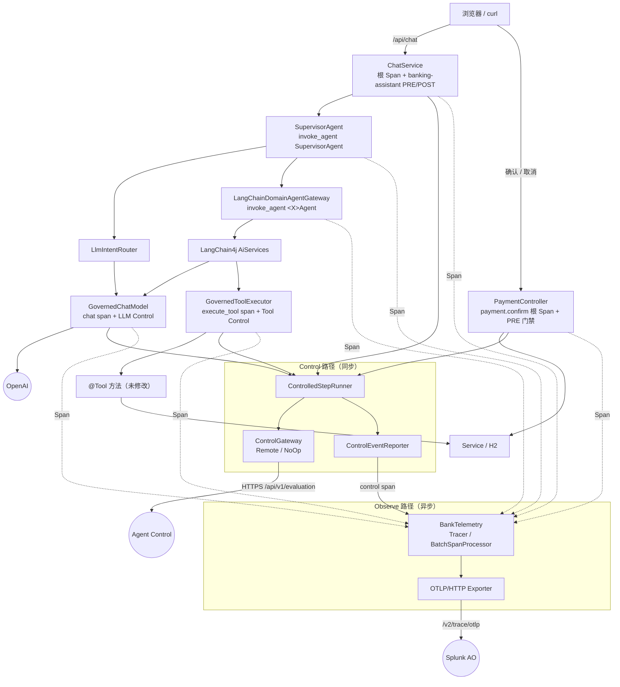
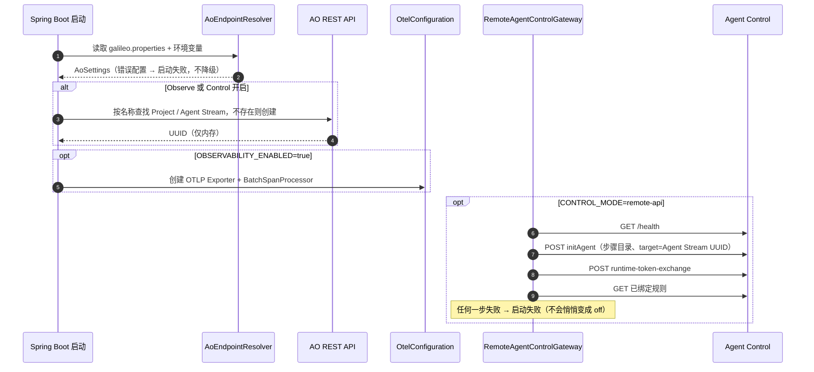
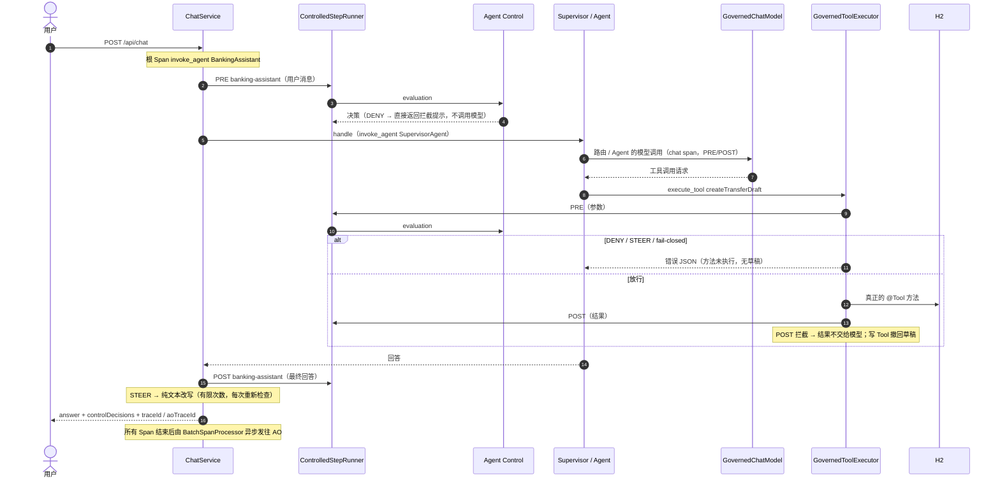

# Phase 2 架构：Observe 与 Agent Control

Phase 2 在 Phase 1 的业务代码外加了两条**相互独立**的数据路径。两个开关可以任意组合，关闭时行为与 Phase 1 完全一致。

| 路径 | 开关 | 方向 | 是否影响业务结果 |
|---|---|---|---|
| **Observe**（OpenTelemetry） | `OBSERVABILITY_ENABLED` | Java → OTLP/HTTP → Splunk AO（异步、批量） | **否**：导出失败只记录日志和计数 |
| **Control**（Agent Control） | `CONTROL_MODE=remote-api` | Java ⇄ Agent Control REST（同步，在请求路径上） | **是**：DENY / STEER / fail-closed 会阻止或改写步骤 |

## 1. 总体结构

设计要点：

- **业务代码基本不动**：`@Tool` 方法、Service、数据库逻辑没有修改；模型和工具通过装饰器（`GovernedChatModel`、`GovernedToolExecutor`）接入，Agent 与根节点只增加了 Span 包装。
- **一个执行点同时负责 Span 和 Control**：Span 在步骤开始前创建，PRE 检查在 Span 内执行，因此 control span 自然成为被检查步骤的子 Span。
- **规则不写在 Java 里**：Java 只知道“步骤名、输入、输出”，决策全部来自服务端。

## 2. 新增的包与类

| 包 | 主要类 | 职责 |
|---|---|---|
| `observability` | `AoRawProperties` → `AoEndpointResolver` → `AoSettings` | 读取 `galileo.properties`，按配置档推导全部地址、认证头与默认值，校验并在启动日志中显示来源（`[derived]` / `[override]` / `[default]`），凭据只显示 set/missing |
| | `AoApiClient`、`AoTargetResolver`、`AoTargetHolder` | 启动时按名称查找或创建 Project / Agent Stream，保存 UUID |
| | `OtelConfiguration`、`BankTelemetry` | 创建 OTel SDK（或 no-op），导出统计 |
| | `AgentSpanRunner`、`GenAiAttributes`、`TraceContentPolicy`、`AoIds`、`DraftTraceRegistry` | Agent Span 写法、属性名、内容过滤、ID 转换、草稿 → 创建 Span 的 link |
| `control` | `ControlGateway`、`RemoteAgentControlGateway`、`NoOpControlGateway` | Agent Control 的 HTTP 客户端（注册、Runtime Token、规则缓存、评估、响应映射） |
| | `ControlledStepRunner`、`ControlOutcome`、`ControlDecision`、`ControlFailureMode` | 决策 → Verdict，failure mode |
| | `ControlEventReporter` | control span（Console Controls 标签）+ UI 执行详情 |
| | `StepCatalog`、`ControlStep`、`StepAccess`、`ControlExceptions` | 步骤目录、读/写属性、Java 异常 |
| `governance` | `StepGovernance`、`GovernedChatModel`、`GovernedToolExecutor` | 包装模型与工具 |
| `tool` | `TransferToolSideEffects` | 写 Tool 输出被拦截时撤回草稿 |
| `cli` | `Phase2Cli` | `scripts/preflight.sh`、`scripts/phase2-smoke.sh` 使用的命令行工具（复用同一个推导器，不启动 Spring） |

修改的 Phase 1 类：`ChatService`、`SupervisorAgent`、`LangChainDomainAgentGateway`、`LlmIntentRouter`、`AgentConfig`、`PaymentController`、`PaymentService`（只新增方法）、`StatusController`、`UiController`、`ExecutionTrace`、`ErrorCode`、`DemoResetService`，以及前端 `app.js` / `index.html` / `app.css`。

## 3. 启动顺序

## 4. 一轮聊天（Observe + Control 都开启）

点击“确认”是另一条独立的 Trace：`payment.confirm` 根 Span → PRE 检查（扣款前）→ `PaymentService.confirm` → POST（仅审计）。它通过 Span link 指向创建草稿的 Tool Span，并与聊天位于同一 AO Session。

## 5. 开关组合

| `OBSERVABILITY_ENABLED` | `CONTROL_MODE` | 行为 | 验证 |
|---|---|---|---|
| `false` | `off` | 与 Phase 1 完全一致：不查找后端、不创建 Span、不发 Control 请求 | `ControlDisabledRegressionIT`、Phase 1 全部测试 |
| `true` | `off` | 只有 Trace；没有 control span；规则不生效 | 在线 O-A/O-B/O-C、C-G |
| `false` | `remote-api` | 规则生效；决策显示在 UI 执行详情中；Console 中没有 Trace | 离线测试；在线未单独验证 |
| `true` | `remote-api` | Trace + 规则 + Controls 标签 | 在线 C-A…C-F、P1 回归 |

`scripts/run.sh --observe` / `--control` / `--trace-content` / `--phase2-off` 只对本次启动的 JVM 设置环境变量，不修改私有配置文件。

## 6. 线程、上下文与隔离

- 一轮聊天在一个 HTTP 工作线程中同步执行（LangChain4j 的工具调用也在同一线程），因此 OTel Context 和 Phase 1 的 `ExecutionTrace`（ThreadLocal）都能沿调用链传递，无需手动跨线程传播。
- Span 导出由 `BatchSpanProcessor` 在后台线程完成，不阻塞请求；队列上限 2048，超出时丢弃 Span 而不是阻塞业务。
- Agent Control 评估在请求线程上同步执行（必须在步骤前得到结果）：典型延迟约 0.26 秒/次；对没有绑定规则的步骤不发请求（规则列表缓存，最多每 5 秒刷新）。
- 应用不把 OTel SDK 注册为全局实例，也让 Spring Boot 自带的 OTel 自动配置退出，避免重复导出。

## 7. 相关文档

- [`PHASE2-JAVA-INSTRUMENTATION.md`](PHASE2-JAVA-INSTRUMENTATION.md)：插桩教程与修改前后代码
- [`PHASE2-CONTROL-API.md`](PHASE2-CONTROL-API.md)：Control 契约、决策映射、各执行点处理
- [`PHASE2-OTEL-SEMANTIC-MAPPING.md`](PHASE2-OTEL-SEMANTIC-MAPPING.md)：Span 属性与 AO 字段
- [`PHASE2-PROTOCOL-VERIFICATION.md`](PHASE2-PROTOCOL-VERIFICATION.md)：P0 协议验证
- [`PHASE2-VALIDATION.md`](PHASE2-VALIDATION.md)：验收结果与已知问题
- [`CONFIG-MAPPING.md`](CONFIG-MAPPING.md)：配置键与推导规则
