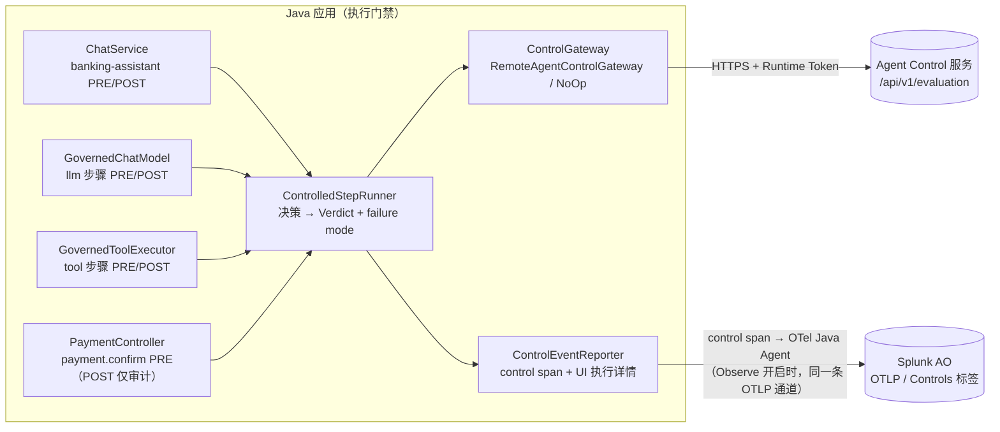

# Agent Control：Java REST Adapter（Galileo 插桩）

本文说明 Java 应用如何使用 Splunk AO 的 Agent Control：规则在 Console（服务端）定义，**执行门禁由 Java 实现**。协议细节与原始验证记录见 [`PROTOCOL-VERIFICATION.md`](PROTOCOL-VERIFICATION.md)，在线验收见 [`VALIDATION.md`](VALIDATION.md)，演示方法见 [`../demo/DEMO-GUIDE.md`](../demo/DEMO-GUIDE.md)。

先说清楚三件事：

- 本项目**没有**使用、也没有假定存在官方的 Java Control SDK。`RemoteAgentControlGateway`、`ControlledStepRunner`、`StepCatalog`、`GovernedChatModel`、`GovernedToolExecutor`、`ControlEventReporter` 都是本项目基于已实测的 REST 接口编写的代码，不是 Splunk / Galileo 官方 Java API。
- Control **不是** OTel 自动插桩：OTel Java Agent 和 LangChain4j 监听器只“看见”步骤，不会阻止任何动作。拦截必须写在业务关口。
- Control 不依赖 Observe：只开 `--control` 时门禁照常生效；Observe 只决定 Console 中能否看到 control span。

## 1. 先弄清楚“谁负责什么”

| 角色 | 负责 | 不负责 |
|---|---|---|
| Console / Agent Control 服务 | 保存规则（作用范围、条件、动作）；收到评估请求后返回决策：`is_safe`、`matches[].action`（deny / steer / observe）、`steering_context` | **不会**中断 Java 程序、不会回滚数据库、不会替 Java 抛异常 |
| Java 应用（本项目） | 在每个受控步骤**之前**（PRE）和**之后**（POST）调用评估接口，并根据决策阻止、改写或放行；把结果写进 Trace（control span）与 UI 执行详情 | 不在 Java 中硬编码规则内容 |
| 官方 Python SDK | `@control()` 装饰器在 Python 进程里做同样的门禁，DENY 时抛 `ControlViolationError`，STEER 时抛 `ControlSteerError` | 这两个异常是 **Python SDK 的行为**，Java 中不存在；本项目用自己的 `ControlDeniedException` / `ControlSteerRejectedException` / `ControlUnavailableException` 表达同样的语义 |

换句话说：在 Console 里打开一条 DENY 规则，如果应用不在对应位置调用评估接口并处理结果，什么都不会发生。

## 2. 执行环境：Server 还是 SDK

Agent Control 规则有两种执行位置：

- **Server**（`"execution": "server"`）：评估在 Agent Control 服务中完成，客户端只发送步骤数据并接收决策。
- **SDK**（`"execution": "sdk"`）：评估器在客户端进程中运行（官方 Python/TypeScript SDK 内置评估器）。

本项目只支持 **Server**：

- 本次调研没有找到官方 Java SDK，Java 无法运行 SDK 评估器；
- Server 执行让 Java 只依赖一个 HTTP 契约，规则改动无需改代码、无需重启；
- 如果某个步骤绑定了 `execution=sdk` 的规则，Adapter 不会假装评估过，而是返回“不可用”（`UNSUPPORTED_EXECUTION`），再按 failure mode 处理（`RemoteAgentControlGateway`）。

HTTP 客户端使用 JDK 自带的 `java.net.http.HttpClient`：不增加依赖，并且与 OpenAI、OTel Java Agent 的 OTLP 导出共用 `scripts/run.sh` 生成的项目专用 truststore（公司 TLS 检查环境；只对本进程生效）。OTel Java Agent 的 `java-http-client` 自动采集已关闭，所以评估请求本身不会在 Trace 中多出一个 HTTP Span。

## 3. REST 契约（已实测）

基础地址：`AGENT_CONTROL_URL`，o11y 默认 `https://app.<realm>.observability.splunkcloud.com/ao/agent-control`。

| 用途 | 请求 | 认证 | 调用时机 |
|---|---|---|---|
| 健康检查 | `GET /health` | `X-SF-Token` | 启动 |
| 注册 Agent 与步骤目录 | `POST /api/v1/agents/initAgent`（`conflict_mode=overwrite`，`target_type=log_stream`，`target_id=<Agent Stream UUID>`） | `X-SF-Token` | 启动 |
| 换取 Runtime Token | `POST /api/v1/auth/runtime-token-exchange` → JWT（5 分钟，`runtime.use`） | `X-SF-Token` | 启动；过期前 30 秒或被拒（401）时刷新一次 |
| 查询已绑定规则 | `GET /api/v1/agents/{agent}/controls?target_type=log_stream&target_id=…` | `X-SF-Token` | 启动；之后最多每 5 秒刷新一次（用于跳过无规则的步骤） |
| **评估** | `POST /api/v1/evaluation` | `X-SF-Token` **+** `X-Agent-Control-Runtime-Token`（只带前者返回 401 `AUTH_MISSING_KEY`） | 每个受控步骤的 PRE / POST |

请求与响应样例见 [`PROTOCOL-VERIFICATION.md`](PROTOCOL-VERIFICATION.md) 第 4 节。超时与重试（`application.yml` → `bank-agent.control.*`）：连接 3 秒、请求 5 秒、评估最多 2 次尝试（只对 5xx/超时重试；评估本身没有业务副作用）、401/403 不重试，错误信息中从不包含 Token。

**两条通道，别混淆**：

- **决策通道 = 同步 REST**：`POST /api/v1/evaluation`，Java 等到结果再决定是否执行步骤。评估接口只返回决策，**不会**在 AO 中留下记录。
- **证据通道 = OTLP control span**：`ControlEventReporter` 用 OTel 公共 API 把每个评估结果写成一个 Span（属性与官方 SDK 的 `set_control_attributes` 相同），挂在被检查步骤的 Span 下面，由**与普通 Observe 相同的 OTel Java Agent、同一条 OTLP 通道**发往 AO。它不是第二个专用上报接口，也不会反过来影响决策。Console 的 Controls 标签读取的就是它（2026-11-02 截图与 2026-11-09 API 回读均已验证）。
- Observe 关闭（没有 Java Agent）时，决策仍然生效并显示在 UI 执行详情中，但没有 control span；`/api/status` 的 `control.eventChannel` 显示 `EVENT_INGEST_UNAVAILABLE`，不会假装上报成功。

## 4. 步骤目录（Console 中可选择的 step name）

启动时由 `StepCatalog` 生成并通过 initAgent 注册，Tool 名称直接取自真实的 `@Tool` 方法，代码与目录不会不一致：

| 类型 | 步骤名 | PRE 的输入 | POST 的输出 | 读/写 |
|---|---|---|---|---|
| llm | `banking-assistant` | 用户消息 | 展示给用户的最终回答 | 读 |
| llm | `supervisor-router` | 路由请求 | 路由 JSON | 读 |
| llm | `account-agent` / `transactions-agent` / `payments-agent` | 发给 OpenAI 的最新用户/任务消息 | 文本回答（工具调用请求在 Tool 处检查） | 读 |
| tool | `getAccountBalance`、`getAccountSummary`、`listBeneficiaries`、`listPaymentMethods`、`listRecentTransactions`、`summarizeSpending`、`getRecentTransferActivity` 等 | 工具参数（JSON） | 工具结果（JSON） | 读 |
| tool | `createTransferDraft`、`cancelPendingTransfer` | 工具参数 | 工具结果 | **写** |
| tool | `payment.confirm` | `{draftRef, beneficiary, beneficiaryId, amount, currency}` | `{status, replayed}` | **写** |

`payment.confirm` 不是 LLM 可调用的 Tool，而是 UI 的“确认”按钮；把它注册为步骤，Console 规则就能在真正扣款前拦截。

## 5. 调用方向



`CONTROL_MODE=off` 时：`StepGovernance` 返回原模型、让 AiServices 走 LangChain4j 默认的 `.tools(bean)` 路径（`GovernedChatModel` / `GovernedToolExecutor` 根本不出现）；`ControlGateway` 是 `NoOpControlGateway`，`ChatService` / `PaymentController` 中的检查直接返回 PROCEED，不发任何请求，也不产生 control span。

## 6. 决策映射（`RemoteAgentControlGateway.mapResponse` + `ControlledStepRunner`）

服务端响应先归一化为一个决策，再结合步骤的读/写属性得到 Verdict：

| 响应 | 决策 | Verdict | 说明 |
|---|---|---|---|
| `matches` 中有 `action=deny` | DENY | **DENY** | 优先级最高（与 SDK 相同） |
| 未知 action（如未来新增的值） | DENY | **DENY** | 偏安全；SDK 也不会放行未知动作 |
| `is_safe=false` 但没有可执行的匹配 | DENY | **DENY** | 偏安全 |
| `errors` 非空（评估器出错），且没有 deny | UNAVAILABLE（`EVALUATOR_ERROR`） | 按 failure mode | **与 SDK 不同**：SDK 一律阻止；本项目对只读步骤可配置 fail-open，并标记为“未检查” |
| 有 `action=steer` | STEER | **STEER** | 带 `steering_context.message` |
| 只有 `action=observe`，或旧值 `allow` / `warn` / `log` | OBSERVE | PROCEED | 不中断；control span 记录命中 |
| 没有匹配 | ALLOW | PROCEED | |
| HTTP 5xx / 超时 / 401 / 403 / 响应格式错误 / 只有 SDK 规则 | UNAVAILABLE | 读：`PROCEED_UNCHECKED`（fail-open）<br/>写：`BLOCKED_UNAVAILABLE`（fail-closed） | 默认值，可用 `CONTROL_READ_FAILURE_MODE` / `CONTROL_WRITE_FAILURE_MODE` 修改；**从不显示为“已通过”** |

## 7. 各执行点如何处理

| 执行点（文件） | DENY | STEER | 不可用（fail-closed） | OBSERVE |
|---|---|---|---|---|
| `ChatService` — `banking-assistant` PRE | 不调用 Supervisor 和任何模型，回答“已被安全策略拦截”，带规则名与原因；用户原文不写入会话记忆 | 不处理，提示用户按指导修改后重发 | 不处理，提示稍后重试 | 继续 |
| `ChatService` — `banking-assistant` POST | 不展示回答 | 用纯文本模型调用改写回答（**不调用 Agent 与 Tool**），每次改写都重新检查；最多 `MAX_CONTROL_STEER_RETRIES`（默认 2）次，仍不通过则不展示 | 不展示回答 | 展示 |
| `GovernedChatModel` — Agent / Router 的 LLM 调用 | PRE：不调用 OpenAI；POST：回答不交给 Agent。两者都抛 `ControlDeniedException`，由 ChatService 转成拦截提示 | PRE：把指导作为 system message 加入后再调用；POST：**不带工具**重新询问模型，有限次数，每次重新检查；所有往返都在同一个 LLM Span 内（token 求和，`bank.control.steer_retries`） | 抛 `ControlUnavailableException` | 继续 |
| `GovernedToolExecutor` — Tool PRE | **Java 方法不执行**；给模型返回 `{"error":"CONTROL_DENIED",…}`，要求向用户说明、不得绕过 | 写 Tool：不执行，本轮锁定该 Tool，要求用户自己修改请求（**绝不让模型自行改金额或收款人**）；读 Tool：不执行，返回指导 | 不执行 | 执行 |
| `GovernedToolExecutor` — Tool POST | 不把结果交给模型；若是写 Tool（`createTransferDraft`），**撤回刚创建的草稿**（CANCELLED，审计码 `CONTROL_WITHDRAWN`，UI 卡片显示“已撤回，未扣款”） | 同 DENY（结果被扣留）并附指导 | 同 DENY | 继续 |
| `PaymentController` — `payment.confirm` PRE | **在 `PaymentService.confirm` 之前**拒绝：HTTP 403 `CONTROL_DENIED`，不扣款，写审计 | HTTP 409 `CONTROL_STEER_REQUIRES_USER_ACTION`：写操作的 STEER 从不自动应用，用户需新建草稿 | HTTP 503 `CONTROL_UNAVAILABLE`，说明“不是策略决定” | 继续确认 |
| `PaymentController` — `payment.confirm` POST | **只审计**：扣款已发生，POST 决策只记录，绝不假装转账没有发生 | 只审计 | 只审计 | — |

### 7.1 支付确认与幂等

- PRE 检查只针对本会话、状态为 `PENDING_CONFIRMATION` 的草稿；其他情况（已执行、已取消、他人草稿）直接交给 `PaymentService.confirm`，保持原有的错误码（`replayed=true`、`DRAFT_CANCELLED` 等）。
- 已执行的草稿再次确认时不再评估，返回 `replayed=true`，不重复扣款（在线 C-F 恢复步骤已验证）。
- 写操作从不自动重试：STEER、DENY 或不可用时只返回给用户，不由模型或代码再次调用。
- 评估请求本身的重试（5xx/超时）没有业务副作用，不影响幂等。

## 8. “Trace 在 Console 可见”不等于“Controls 标签有详情”

| 情况 | 结果 | 证据 |
|---|---|---|
| 只有 Observe（`--observe`） | Trace、父子树、token 正常；**没有 control span，也没有 Controls 标签内容**；业务不受任何规则约束（如“向王五转账”照常生成草稿）；模型和 Tool 不经过任何 Control 包装 | 离线 `ObserveOnlySpanIT`、`OtelJavaAgentIT`；在线 2026-11-09 smoke（[`VALIDATION.md`](VALIDATION.md) 第 3 节） |
| 只有 Control（`--control`） | 决策照常执行（拦截有效），UI 执行详情中可见；没有 Java Agent，Console 中没有这次请求的 Trace，也没有 Controls 详情；`eventChannel=EVENT_INGEST_UNAVAILABLE` | 离线 `OtelJavaAgentIT`（独立 JVM，零导出）；在线 2026-11-09：王五转账 DENY、无草稿、`traceId` 为空 |
| Control + Observe（两个都开） | Controls 标签显示控件名、Triggered、Applies To、Evaluator、Trigger if、View control，与被检查的步骤关联 | 在线 2026-11-09 API 回读：control span 挂在 Tool / 根 / `payment.confirm` 下；2026-11-02 旧实现的 Console 截图（Controls 标签字段与协议相同） |
| 自定义属性（如 `bank.control.pre.verdict`）不带 `galileo.span.kind=control` | 只出现在 Span metadata 中，**不会**出现在 Controls 标签 | 应用的 Tool/LLM span 同时带有这些属性，Console 中可对比 |

## 9. STEER 与 PII 脱敏的区别

- **STEER** 是一条**指导**（`steering_context.message`）：服务端告诉应用“按这个要求重新生成或调整”。应用用它让模型改写回答，或让用户修改请求。改写结果仍是模型的新输出，所以必须再检查一次；它不保证与原文一一对应，也不能还原原文。
- **PII 脱敏 / Redaction** 是对数据的确定性变换（遮盖、替换或令牌化，部分方案可逆）。本项目没有使用 Agent Control 的脱敏功能；Trace 中的内容过滤（`TraceContentPolicy`：默认不导出正文、遮蔽密钥和长数字）是 Java 端的本地逻辑，与 Control 无关。
- 因此不要把 STEER 当作“PII 令牌化”：被 STEER 的输出不会被保存后再还原；需要隐藏某字段时，应使用 DENY（不返回）或在业务层面不提供该字段。

## 10. 配置

| 键 | 默认 | 说明 |
|---|---|---|
| `CONTROL_MODE` | `off` | `remote-api` 开启；与 `OBSERVABILITY_ENABLED` 相互独立 |
| `AGENT_CONTROL_URL` | 按配置档推导 | o11y：`https://app.<realm>.observability.splunkcloud.com/ao/agent-control` |
| `AGENT_CONTROL_EVALUATION_PATH` | `/api/v1/evaluation` | 协议验证实测 |
| `AGENT_CONTROL_RUNTIME_AUTH_MODE` / `…_TOKEN_HEADER` | `jwt` / `X-Agent-Control-Runtime-Token` | 协议验证实测：评估接口必须带 Runtime Token |
| `AGENT_CONTROL_AGENT_NAME` | `bank-agent-java` | 至少 10 个字符，`[a-z0-9:_-]` |
| `CONTROL_READ_FAILURE_MODE` / `CONTROL_WRITE_FAILURE_MODE` | `fail-open` / `fail-closed` | 服务不可用时的处理 |
| `MAX_CONTROL_STEER_RETRIES` | `2` | STEER 的最大改写次数 |

开启 `remote-api` 但缺少地址、凭据或无法解析 Agent Stream 时，应用**启动失败**并给出原因，不会悄悄降级为 `off`。完整推导规则见 [`../CONFIG-MAPPING.md`](../CONFIG-MAPPING.md)。

## 11. 规则的管理接口

规则由服务端保存，Java 应用只读取和评估，不创建规则。管理接口（`X-SF-Token`）：

```text
PUT   {AGENT_CONTROL_URL}/api/v1/controls                 {"name": "...", "data": {...}}                       → {"control_id": N}
PUT   {AGENT_CONTROL_URL}/api/v1/control-bindings/by-key  {"target_type": "log_stream", "target_id": "<stream uuid>",
                                                           "control_id": N, "enabled": true}                    → 绑定到 Agent Stream
PATCH {AGENT_CONTROL_URL}/api/v1/control-bindings/by-key  （同上，"enabled": false）                             → 停用绑定
PUT   {AGENT_CONTROL_URL}/api/v1/controls/{N}/data        {"data": {...}}                                      → 修改条件，无需重启应用
```

Console 中 Agent Stream → **Controls** 列表的开关对应的是规则与该 Stream 的绑定：协议验证时通过上面的 PATCH 停用的规则 13–15，在该列表中显示为关闭。演示用的 6 条规则、它们的定义文件和创建步骤见 [`../demo/DEMO-GUIDE.md`](../demo/DEMO-GUIDE.md)。

## 12. 与官方 Python SDK 的差异

| 方面 | 官方 Python SDK | 本项目 Java Adapter |
|---|---|---|
| 门禁 | `@control()` 装饰器，抛 Python 异常 | 显式执行点（ChatService、GovernedChatModel、GovernedToolExecutor、PaymentController），只在 Control 开启时插入，抛 Java 异常或返回给模型的错误 JSON |
| 评估器错误 | 一律阻止 | 交给 failure mode（只读可 fail-open，并标记“未检查”） |
| SDK 执行的规则 | 在本地运行 | 不支持，返回“不可用” |
| Control 结果上报 | bridge 把结果转为 control span（OTLP） | 相同属性的 control span，由 OTel Java Agent 经同一条 OTLP 通道导出 |
| 预过滤 | 只对有规则适用的步骤发评估请求 | 相同，规则列表最多每 5 秒刷新 |

## 13. 哪些必须手工、为什么

| 位置 | 为什么不能交给框架监听或 OTel 自动插桩 |
|---|---|
| Tool PRE（`GovernedToolExecutor`） | DENY 必须在 Java 方法运行**之前**生效；`afterToolExecution` / `ToolExecutedEvent` 是执行后的通知，写操作已经发生 |
| Tool POST 撤回（`TransferToolSideEffects`） | 输出被拦截时要把刚创建的草稿取消并审计，这是业务补偿，框架不知道“草稿”是什么 |
| 模型 PRE / POST 与 STEER（`GovernedChatModel`） | 要在请求发给 OpenAI 之前检查，并在回答交给 Agent 之前扣留或有限次重试；LangChain4j Guardrails 的 reprompt 会带着工具定义重新进入循环，可能再次触发写 Tool，所以没有采用 |
| 用户消息 / 最终回答（`ChatService`） | 一轮对话的入口与出口是应用自己的编排（Supervisor + 多个 AI Service），框架没有“整轮”事件 |
| 确认扣款（`PaymentController`） | 扣款由 UI 按钮触发，不是 LangChain4j Tool；必须在 `PaymentService.confirm` 之前拒绝（403/409/503） |
| control span（`ControlEventReporter`） | 评估接口不入库；AO Controls 标签需要特定属性的 Span。它由 Control 层自动生成，业务代码不用写 |
