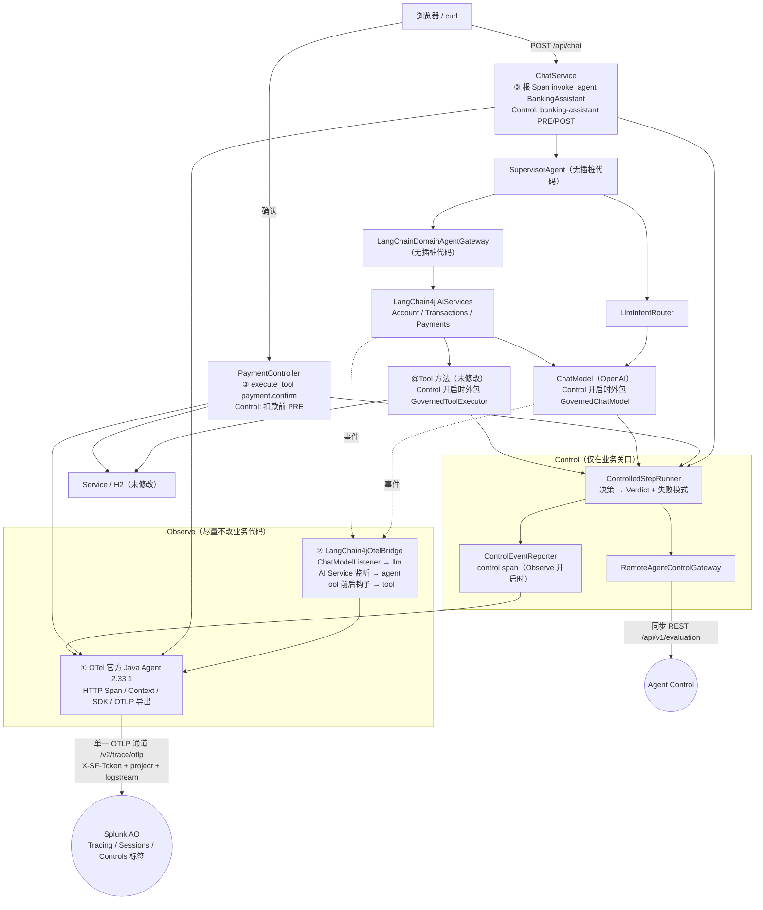
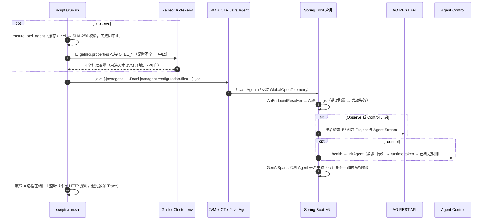
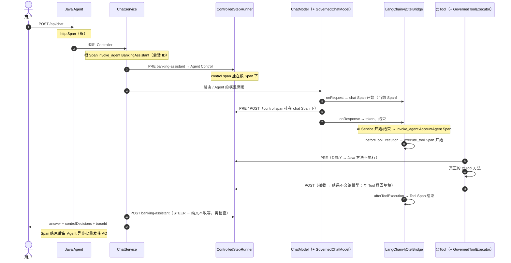

# Galileo 插桩架构：Observe 自动、Control 精准、出口统一

Galileo 插桩在银行 AI 应用之外加了两条**相互独立**的路径。两个开关可以任意组合；都关闭时，应用与没有插桩时完全一致（不挂载 Java Agent、不发任何后端请求）。

| 路径 | 开关 | 由谁完成 | 方向 | 是否影响业务结果 |
|---|---|---|---|---|
| **Observe** | `scripts/run.sh --observe`（`OBSERVABILITY_ENABLED=true`） | OTel 官方 Java Agent + LangChain4j 官方扩展点（1 个适配类）+ 2 处手写 Span | Java Agent → OTLP/HTTP → Splunk AO（异步、批量） | **否**：导出失败只在日志中出现 |
| **Control** | `scripts/run.sh --control`（`CONTROL_MODE=remote-api`） | 本项目的 Control Adapter（业务关口的 PRE/POST） | Java ⇄ Agent Control REST（同步，在请求路径上） | **是**：DENY / STEER / fail-closed 会阻止或改写步骤 |

## 1. 总体结构

要点：

- **只有一个 OTel Provider / Exporter**：Java Agent 的 SDK。应用只依赖 `opentelemetry-api`，所有 Span（自动的、适配类的、手写的、Control 的）都经过它导出。没有 Java Agent 时 API 是空实现。
- **Control 的两条通道**：**决策**走同步 REST（Java 等结果再决定是否执行）；**证据**（control span）走 Observe 的同一条 OTLP 通道，不是另一个上报接口。Observe 关闭、Control 开启时，业务门禁照常执行，本地 UI 显示决策，但 Console 没有对应 Trace 与 Controls 记录。
- **Observe-only 不经过任何 Control 代码**：`StepGovernance` 在 Control 关闭时返回原模型、使用 LangChain4j 默认的 `.tools(bean)`。
- **不重复**：同一次模型调用只有一个 `chat` Span（Control 包装器把监听器交给外层，自己不建 Span），同一次 Tool 调用只有一个 `execute_tool` Span；OpenAI 的原始 HTTP 请求、ORM 层不再单独成 Span。

## 2. 开关组合

| Observe | Control | 行为 | 离线验证 | 在线验证（2026-11-09，au0） |
|---|---|---|---|---|
| 关 | 关 | 与未插桩时一致：不挂 Agent、不查后端、不发 Control 请求 | `ControlDisabledRegressionIT`、`OtelJavaAgentIT` 第 4 例、全部业务测试 | 回答正常；进程只连接 OpenAI，无任何到 Splunk 主机的连接 |
| 开 | 关 | Agent / LLM / Tool 树、token、Session；无 Control Span；LangChain4j 走默认路径 | `ObserveOnlySpanIT`、`OtelJavaAgentIT` 第 1 例（真实 `-javaagent`） | smoke 3 题 + 多轮 Session + 确认 Trace，均在 AO 回读到 |
| 关 | 开 | 规则在 PRE/POST 真实执行；决策显示在 UI；不导出 | `OtelJavaAgentIT` 第 3 例、`ControlledToolFlowIT` | 王五转账被 DENY、无草稿、无 Trace；`eventChannel=EVENT_INGEST_UNAVAILABLE` |
| 开 | 开 | 同一 Trace 中 Agent / LLM / Tool + 挂在被检查步骤下的 Control Span | `OtelSpanStructureIT`、`OtelJavaAgentIT` 第 2 例 | C-A…C-E、注入、STEER 改写、规则热更新、故障演练、9 题业务回归 |

## 3. 源码职责清单

| 文件 | 职责 | 类型 |
|---|---|---|
| `config/otel-javaagent.properties` | Java Agent 的通用设置（导出器、关闭的自动采集模块及原因） | 配置（无密钥） |
| `scripts/lib/common.sh` → `ensure_otel_agent`、`otel_agent_setup` | 固定版本 + SHA-256、下载缓存到仓库外、推导 `OTEL_*`、只对本 JVM 加 `-javaagent` | 启动脚本 |
| `observability/OtelConfig` | `OpenTelemetry` = `GlobalOpenTelemetry.get()`（Agent 的 SDK 或空实现） | 本项目，5 行 |
| `observability/GenAiSpans` | 唯一取得 Tracer 的地方；根/确认 Span 的写法；Context 修复；错误记录（不导出堆栈） | 本项目 |
| `observability/LangChain4jOtelBridge` | LangChain4j 事件 → GenAI Span（llm / agent / tool） | 本项目，**唯一的 Observe 适配层** |
| `observability/GenAiAttributes`、`TraceContentPolicy`、`AoIds` | 属性名；默认不导出正文；OTel trace ID → AO UUID | 本项目 |
| `observability/AoEndpointResolver` → `AoSettings` | 从 `galileo.properties` 推导所有地址与凭据（含 `otelAgentEnvironment()`），唯一实现 | 本项目 |
| `observability/AoTargetResolver`、`AoTargetHolder`、`AoApiClient` | 启动时按名称查找/创建 Project 与 Agent Stream（Control 需要其 UUID） | 本项目 |
| `conversation/ChatService` | 根 Span；`banking-assistant` PRE/POST；STEER 改写 | 业务 + 手写 |
| `api/PaymentController` | `payment.confirm` Span；扣款前 PRE、扣款后审计 | 业务 + 手写 |
| `governance/StepGovernance` | Control 关：原模型 + 默认 Tool 路径；Control 开：插入两个门禁包装 | Control |
| `governance/GovernedChatModel`、`GovernedToolExecutor` | 只做 PRE/POST 门禁与 STEER；不创建 Span | Control |
| `control/*` | REST 契约、Runtime Token、规则缓存、决策映射、失败模式、步骤目录、control span | Control |
| `tool/TransferToolSideEffects` | 写 Tool 输出被拦截后撤回草稿 | Control（业务补偿） |
| `cli/GalileoCli` | `otel-env` / `preflight` / `smoke` / `trace` | 工具 |

已删除：`OtelConfiguration`、`BankTelemetry`（自建 SDK 与导出器）、`AgentSpanRunner`、`DraftTraceRegistry`（确认 → 草稿的 Span link）。

## 4. 启动顺序

## 5. 一轮聊天（Observe + Control 都开启）

点击“确认”是另一条独立 Trace：`http POST /api/payments/drafts/{draftId}/confirm` → `execute_tool payment.confirm` → PRE 检查（扣款前）→ `PaymentService.confirm` → POST（仅审计）。它带同一个 `gen_ai.conversation.id`，在 AO 中与聊天位于同一 Session（2026-11-09 在线回读确认）。

## 6. 选型与舍弃方案

按任务书 2.1 的顺序逐一验证，“PoC”均为本次实际运行，不是推测。

| 候选 | 实测证据 | 结论 |
|---|---|---|
| **A. OTel 官方 Java Agent** 2.33.1 | PoC A：原应用（手写 Observe 关闭）挂载 Agent，`logging-otlp` 输出。得到 Tomcat `POST /api/chat`、3 个 `java-http-client` 的 `POST`（OpenAI）、Spring Data → Hibernate → JDBC 三层查询、首次启动约 100 个建表/种子数据 SQL Span（42 条与请求无关的独立 Trace）；**没有任何 AI 语义**。Agent 的 GenAI 插桩只覆盖 `openai-java` 1.1+（jar 中只有 `openai-java-1.1` 模块），不覆盖 LangChain4j。AO 在线：HTTP 根节点被识别为 `http` 类型；只有 HTTP Span 的 Trace（`/api/status`、`/`、`/actuator/health`）按 trace ID 查询 >20 分钟仍为 404（未入库） | **采用为底座**（SDK、导出、HTTP、上下文）；关闭 `java-http-client`、`spring-data`、`hibernate`、`jdbc`，原因见 [`JAVA-INSTRUMENTATION.md`](JAVA-INSTRUMENTATION.md) 2.1 |
| **B. `langchain4j-observation`** 1.23.0-beta33 + Micrometer Tracing OTel bridge | PoC B：用 `micrometer-tracing-bridge-otel` 1.6.8 + 内存 SDK 运行一个带 Tool 的 AI Service。只产生 2 个 `chat gpt-5-nano` Span（`INTERNAL`），属性为 `gen_ai.operation.name`、`gen_ai.provider.name=OPEN_AI`（枚举名，不是 `openai`）、请求/响应模型、`input_tokens` / `output_tokens`（**不是** AO 解析的 `gen_ai.usage.*`）、`outcome`；没有 Agent / Tool、会话 ID、消息。需要 Micrometer 1.16.5（Spring Boot 3.5.16 管理 1.15.12）和第二套 Tracing 桥接（与 Agent 的 HTTP Span 有重复风险） | **舍弃**：AO 看不到 token，且只覆盖 LLM |
| **C. LangChain4j 原生监听** `ChatModelListener` + AI Service 监听 + `before/afterToolExecution` | 读 1.23.0 源码：三组回调都在调用线程同步成对触发；LLM 在请求前开始、Tool 在 Java 方法前开始；`AiServiceErrorEvent` 在 `catch (Throwable)` 中触发。`ToolExecutedEvent` 只在执行后触发（未使用）。离线测试 + 真实 Agent 黑盒测试 + 在线 AO 回读 | **采用**：一个适配类、注册一次，补齐 Agent / LLM / Tool |
| **D. 第三方适配器** | `com.arize:openinference-instrumentation-langchain4j` 0.1.9（Maven Central 正式版，2026-09-25）：挂在同样的 LangChain4j 事件上，但 Tool 来自执行后的 `ToolExecutedEvent`；输出 OpenInference 字段（`openinference.span.kind`、`input.value`、`llm.token_count.*`），不是 `gen_ai.*`；依赖 `opentelemetry-instrumentation-api-incubator` 2.14.0-alpha。`otel-genai-bridges`：Maven Central 上没有制品（示例依赖 0.1.0-SNAPSHOT）。**均未做 AO 在线 PoC** | **未采用**：AO o11y 对 OpenInference 字段的解析未经验证；Tool 起始时间不准确；而 C 已能用同样的事件产出 AO 已验证的格式 |
| **E. 最少手写 Span** | 根 Agent（`ChatService`）、UI 确认（`PaymentController`）、control span（`ControlEventReporter`） | **仅用于框架没有事件的位置**，原因见 [`JAVA-INSTRUMENTATION.md`](JAVA-INSTRUMENTATION.md) 2.3、第 4 节 |
| OTel Spring Boot Starter | 未作为默认：与 Java Agent 不能双开；Agent 不需要改 `pom.xml`、对任何 Java 应用通用，更符合“启动时挂载、不改代码”的演示目的 | 不采用 |
| LangChain4j Guardrails（用于 Control） | `OutputGuardrail` 的 reprompt 会带着工具定义重新进入 AI Service 循环（STEER 时可能再次调用写 Tool）；路由不是 AI Service | Control 不采用，保留显式门禁 |
| 实验性 `otel.java.experimental.span-attributes.copy-from-baggage.include` | Agent 2.33.1 支持，可把会话 ID 从 Baggage 自动复制到所有 Span | 标记为 experimental，且 Baggage 会随出站 HTTP 头传播；未采用，会话 ID 通过 Context 传给子 Span |

最终组合：**A + C + 极少量 E**。

## 7. 线程、上下文与隔离

- 一轮聊天在一个 HTTP 工作线程中同步执行（LangChain4j 默认顺序执行 Tool），OTel Context 与应用自己的 `ExecutionTrace`（UI 执行详情）都沿调用链传递。
- 会话 ID 通过 OTel Context 中的应用私有 key 传给 LLM Span（`ChatModelListener` 拿不到 AI Service 的 memory ID）；它不进入 Baggage，不随出站请求传播。
- 导出由 Java Agent 的批量处理器在后台线程完成，不阻塞请求；导出失败只影响观测，不影响业务。
- Agent Control 评估在请求线程上同步执行（约 0.26 秒/次）；没有绑定规则的步骤不发请求（规则列表最多每 5 秒刷新）。
- 项目专用 truststore（公司 TLS 检查环境）通过 JVM 参数只对本进程生效，OpenAI、Agent Control 与 Agent 的 OTLP 导出共用它（在线验证）。

## 8. 改造前后对比

| 指标 | 改造前（2026-11-02） | 改造后 |
|---|---|---|
| 应用运行时的 OTel jar | 12 个（API、SDK、trace/metrics/logs、OTLP exporter、JDK sender…） | **2 个**（`opentelemetry-api`、`opentelemetry-context`）；SDK 与导出器由 Java Agent 提供 |
| 应用自建的 SDK / Exporter / Provider | `OtelConfiguration` + `BankTelemetry`（220 行） | **0** |
| 业务 / 框架类中手写 Span 的位置 | 7 处：`ChatService`、`SupervisorAgent`、`LangChainDomainAgentGateway`、`PaymentController`（确认、取消）、`GovernedChatModel`、`GovernedToolExecutor` | **2 处**：`ChatService`、`PaymentController`（确认）；Agent / LLM / Tool 由 1 个适配类集中生成 |
| 只开 Observe 时是否经过 Control 包装 | 是（模型与每个 `@Tool` 都被装饰） | **否**（LangChain4j 默认路径） |
| 只为 Observe 而改动的业务类 | `SupervisorAgent`、`LangChainDomainAgentGateway`、`DemoResetService`、`TransferToolSideEffects`（草稿 → Span 登记） | **恢复为插桩前原样**（`TransferToolSideEffects` 只保留 Control 的撤回） |
| 业务包（agent / conversation / api / tool / service / llm）相对插桩前的改动 | 13 个文件，+678 / −61 | 12 个文件，+574 / −48（剩余主要是 Control 门禁与状态展示） |
| Observe-only 启动步骤 | `--observe`（应用内 SDK） | `--observe`（挂载官方 Agent；客户自己的应用：`-javaagent` + 4 个标准 `OTEL_*` 变量） |
| 默认 Span 树 | BankingAssistant → SupervisorAgent → Router LLM → 领域 Agent → … | http → BankingAssistant → Router LLM + 领域 Agent → LLM / Tool（去掉 SupervisorAgent 一层；新增自动 HTTP 根） |
| 失去的特性 | — | 确认 Trace → 草稿创建 Span 的 OTel link（AO 的 Trace/Span 记录没有 link 字段，Console 不展示；改为同一 Session + `bank.draft.ref`）；`splunk_ao.status_code`（AO 只当 metadata，K2）；`/api/status` 的导出计数（由 Agent 负责导出，应用不再持有导出器） |
| 新增的特性 | — | HTTP 路由 / 状态码 / 总耗时自动采集；真实 `-javaagent` 黑盒测试；四种开关组合的自动化验收 |

## 9. 相关文档

- [`QUICKSTART.md`](QUICKSTART.md)：5 分钟版本
- [`JAVA-INSTRUMENTATION.md`](JAVA-INSTRUMENTATION.md)：三层插桩、谁做了什么、剩余手工点
- [`AGENT-CONTROL.md`](AGENT-CONTROL.md)：Control 契约、决策映射、各执行点处理
- [`OTEL-SEMANTIC-MAPPING.md`](OTEL-SEMANTIC-MAPPING.md)：Span 来源、属性与 AO 字段
- [`PROTOCOL-VERIFICATION.md`](PROTOCOL-VERIFICATION.md)：协议验证（含重构后复核）
- [`VALIDATION.md`](VALIDATION.md)：验收结果与已知问题
- [`../CONFIG-MAPPING.md`](../CONFIG-MAPPING.md)：配置键、`OTEL_*` 推导
- [`../demo/DEMO-GUIDE.md`](../demo/DEMO-GUIDE.md)：演示故事线
