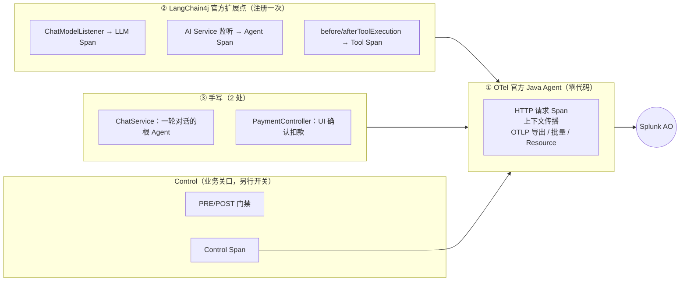

# Galileo Java 插桩教程（写给不熟悉 Java 的读者）

读完本文，你能说清楚：本项目的 Observe（观测）和 Control（管控）**各由谁完成、哪些是自动的、哪些必须手写、为什么**，并能自己运行一次、在 Splunk AO Console 中找到结果。所有代码片段都摘自当前能编译、测试通过的源码。只想要 5 分钟版本，请先读 [`QUICKSTART.md`](QUICKSTART.md)。

## 0. 结论先行

- **Observe 不需要逐个业务类写代码**：
  - OTel（OpenTelemetry，开放遥测标准）**官方 Java Agent** 在启动时挂载，负责 HTTP 请求 Span、调用上下文、OTLP 导出——零代码；
  - **LangChain4j 官方扩展点**（模型监听、AI Service 监听、Tool 前后钩子）由一个适配类 `LangChain4jOtelBridge` 翻译成 AO 能识别的 GenAI Span——注册一次；
  - 只剩 **2 处手写 Span**（一轮对话的根、UI 确认扣款），因为框架里没有对应的事件。
- **Control 必须在业务关口手写**：Agent Control 服务只给决策，拦截要由 Java 在动作发生**之前**完成；这不是 OTel 的自动插桩，也不是 Splunk 提供的 Java SDK，而是本项目基于已验证 REST 接口写的 Adapter。
- **Control 结果要在 Console 中可见**，需要把评估结果写成 control span，经同一个 Java Agent 上报；这部分由 Control 层自动生成，业务代码不用管。



## 1. 先认识几个 Java 概念

| 概念 | 一句话解释 | 在本项目中的例子 |
|---|---|---|
| JVM / jar | Java 程序的运行环境 / 打包好的程序 | `java -jar target/bank-agent-java.jar` |
| **Java Agent（`-javaagent`）** | 启动 JVM 时额外挂载的程序，可以在不改源码的情况下给常用库“加上”采集逻辑 | `java -javaagent:opentelemetry-javaagent.jar -jar …` |
| Spring Bean | 由 Spring 框架创建并管理、全应用共享的对象 | `@Component`、`@Configuration`、`@Bean` |
| LangChain4j AI Service | 用一个 Java 接口声明的 Agent，LangChain4j 负责调用模型和 Tool | `AccountAgent`、`PaymentsAgent` |
| `@Tool` | 标记“这个 Java 方法可以给模型调用” | `AccountTools.getAccountBalance` |
| **Listener / Hook（监听器 / 钩子）** | 框架在某件事前后主动通知你的回调 | `ChatModelListener.onRequest / onResponse` |
| 装饰器（Decorator） | 把一个对象包起来，在调用前后加逻辑，对外接口不变 | `GovernedChatModel` 包装 `ChatModel`（只用于 Control） |
| `try-with-resources` | `try (X x = …) {}` 结束时一定调用 `x.close()` | `try (Scope s = …)` 保证“当前 Span”一定被恢复 |

OTel 的三个概念：**Trace**（一次请求的整棵树）、**Span**（一个步骤）、**Context / Scope**（“当前是哪个 Span”，决定新 Span 的父节点）。

## 2. 第一层：只开 Observe

### 2.1 OTel 官方 Java Agent【OTel 官方】——零代码

- **做什么**：
  - 每个 HTTP 请求一个 SERVER Span（如 `POST /api/chat`），作为 Trace 的根；AO 中显示为 `http` 类型节点；
  - 在线程中维护 OTel Context，应用里任何 `Span.current()` 都能拿到正确的父节点；
  - 提供 SDK、批量导出器、OTLP/HTTP protobuf 发送、Resource（服务名、路由属性）；
  - 把应用代码使用的 OTel API 接到它自己的 SDK 上（应用只依赖 `opentelemetry-api`，没有 SDK）。
- **怎么启用**：`scripts/run.sh --observe` 只对本次启动的 JVM 加 `-javaagent`，不改 JDK、不设置全局 `JAVA_TOOL_OPTIONS`：
  - 版本 **2.33.1**、SHA-256 固定（`scripts/lib/common.sh`）；首次通过 Maven Wrapper 从 Maven Central 下载到 `~/.local/share/bank-agent-java/otel/`（仓库外），之后复用；校验失败或下载失败时**启动中止**，不会假装已观测；离线可用 `BANK_AGENT_OTEL_AGENT_JAR=<路径>` 指定已有的 jar（同样校验）。
  - 非机密的通用设置在 [`config/otel-javaagent.properties`](../../config/otel-javaagent.properties)（`-Dotel.javaagent.configuration-file=…`）；
  - AO 专属的 4 个标准变量由 `GalileoCli otel-env` 从私有 `galileo.properties` 推导（与应用使用同一套推导规则 `AoEndpointResolver`），只导出到这次 JVM 的环境，**从不打印**：

| 标准变量 | o11y（Splunk AO SaaS）的值 | 来源 |
|---|---|---|
| `OTEL_EXPORTER_OTLP_TRACES_ENDPOINT` | `https://ingest.<realm>.observability.splunkcloud.com/v2/trace/otlp` | `AO_REALM` 推导（可用 `AO_OTLP_ENDPOINT` 覆盖） |
| `OTEL_EXPORTER_OTLP_TRACES_HEADERS` | `X-SF-Token=<token>,project=<项目名>,logstream=<Agent Stream 名>` | `AO_O11Y_TOKEN`、`AO_PROJECT_NAME`、`AO_AGENT_STREAM` |
| `OTEL_RESOURCE_ATTRIBUTES` | `deployment.environment.name=local-demo,splunk_ao.project.name=…,splunk_ao.logstream.name=…` | 同上 |
| `OTEL_SERVICE_NAME` | `bank-agent-java` | 默认值（可覆盖） |

- **关掉了哪些自动采集、为什么**（`config/otel-javaagent.properties`，均有注释）：

| Agent 模块 | 处理 | 原因（均经 PoC 实测） |
|---|---|---|
| Tomcat / Spring Web MVC | **保留** | HTTP 入口、路由、状态码、总耗时；AO 显示为 `http` 根节点 |
| `java-http-client` | 关闭 | LangChain4j 调 OpenAI 的 HTTP 请求会变成第二个、没有 AI 语义的 `POST` Span，与 LLM Span 重复；也会采集 Agent Control / AO REST 调用 |
| `spring-data`、`hibernate` | 关闭 | 一次查询会产生 Repository → Hibernate → JDBC 三层嵌套 Span |
| `jdbc` | 关闭（可选开启） | 能用：SQL（参数已脱敏）自动挂在 Tool 下，AO 显示为 `workflow` 节点。但①启动时建表/初始化数据的 SQL 不在任何请求内，每条变成一个独立 Trace；②嵌入式 H2 文件库的 Span 名、`db.namespace`、`db.connection_string` 含本机文件路径（含用户名）。连接 PostgreSQL 等服务器数据库时，设置 `OTEL_INSTRUMENTATION_JDBC_ENABLED=true` 即可开启 |
| metrics / logs 导出 | 关闭 | AO 端点只接收 Trace |

### 2.2 LangChain4j 官方扩展点【LangChain4j 官方 + 本项目适配类】——注册一次

LangChain4j 1.23.0 在三个位置提供官方回调，本项目用一个类 `observability/LangChain4jOtelBridge` 把它们翻译成 OTel GenAI 语义约定的 Span（`gen_ai.*` 属性，AO 据此识别类型）：

| LangChain4j 回调 | 触发时机 | 生成 | AO 类型 |
|---|---|---|---|
| `ChatModelListener.onRequest` / `onResponse` / `onError` | 每次模型调用之前 / 之后 / 出错 | `chat <model>`：模型、真实 token、结束原因 | `llm` |
| AI Service 监听：`AiServiceStartedListener` / `CompletedListener` / `ErrorListener` | Agent 调用开始 / 结束 / 出错 | `invoke_agent <AccountAgent…>` | `agent` |
| `beforeToolExecution` / `afterToolExecution` | Tool Java 方法**运行之前** / 之后 | `execute_tool <工具名>` | `tool` |

注册位置只有两处（`llm/LlmConfig.java`、`agent/AgentConfig.java`）：

```java
// LlmConfig：模型上注册一次（UI 执行详情 + GenAI Span）
OpenAiChatModel.builder() ... .listeners(List.of(new TraceChatModelListener(), otel));

// AgentConfig：每个 AI Service 构建时注册一次（三个 Agent 共用同一段代码）
AiServices.builder(type)
        .chatModel(control.chatModel(chatModel, StepCatalog.agentStep(agent)))   // Control 关闭时就是原模型
        ...
        .registerListeners(otel.aiServiceListeners())        // Agent Span
        .beforeToolExecution(otel::toolStarted)               // Tool Span 开始
        .afterToolExecution(execution -> {
            recordToolExecution(execution);                   // 原有的 UI 执行详情
            otel.toolFinished(execution);                     // Tool Span 结束
        })
```

几个关键事实（读过 LangChain4j 1.23.0 源码、并用测试验证）：

- 这些回调都在**调用线程上同步**执行，开始/结束成对出现（`ChatModel.chat` 用 try/catch 包住模型调用；Tool 前后钩子包住 Tool 执行器）。所以 Span 在“开始”回调中被设为当前、在“结束”回调中恢复，子节点（例如 Control Span）自然挂在正确的父节点下。
- LLM Span 在**模型调用之前**开始（`onRequest`），不是用事后回调倒推时间；Tool Span 在 **Java 方法运行之前**开始（`beforeToolExecution`）。框架的 `ToolExecutedEvent` 只在执行后触发，所以没有用它。
- 万一某个“结束”回调因严重错误没有执行，`GenAiSpans.makeCurrent` 返回的 Scope 在外层关闭时会修复线程上的 Context，泄漏的 Span 不会成为后续请求的父节点（`OtelSpanStructureIT` 断言每次请求后 Context 为空）。
- 没有挂载 Java Agent 时，OTel API 是空实现，适配类的每个回调直接返回，不产生任何开销和网络请求。

### 2.3 两处手写 Span【本项目】——以及为什么无法自动

| 文件 | Span | 为什么框架给不了 |
|---|---|---|
| `conversation/ChatService.java` | `invoke_agent BankingAssistant`（一轮对话的根；带 `gen_ai.conversation.id` → AO Session） | 一轮 = Supervisor 路由 + 0–3 个 AI Service，是应用自己的编排，不是一次框架调用；Session 归属和 `banking-assistant` 的 Control 都需要这一个节点 |
| `api/PaymentController.java` | `execute_tool payment.confirm`（UI 点击确认，独立 Trace） | 扣款由用户按钮触发，不是 LangChain4j Tool 调用，没有框架事件；需要它带会话 ID 进入同一 Session，并作为 `payment.confirm` 的 Control 挂载点 |

`ChatService` 中的全部 Observe 代码（约 9 行，节选）：

```java
Span root = spans.startAgent(ROOT_AGENT, conversation.getId(), message);
try (Scope ignored = GenAiSpans.makeCurrent(root, conversation.getId())) {
    trace.setTraceId(GenAiSpans.traceId(root));                 // UI 显示 Trace ID
    ... 原有业务逻辑 ...
    root.setAttribute(GenAiAttributes.BANK_INTENT, turn.intent());
    spans.setOutput(root, turn.answer());                       // 默认只导出占位符
} catch (RuntimeException e) {
    GenAiSpans.recordFailure(root, e);                          // error.type，不导出堆栈
    throw e;
} finally {
    root.end();
}
```

其他业务类——`SupervisorAgent`、`LangChainDomainAgentGateway`、所有 `@Tool`、Service、Repository、数据库——**没有任何 Observe 代码**；`SupervisorAgent`、`LangChainDomainAgentGateway`、`DemoResetService` 已恢复为插桩前的原样。

## 3. 第二层：加 Control 评估

### 3.1 Agent Control 服务【Splunk AO 平台】

- 保存规则（作用范围、条件、动作），对每个评估请求返回决策：DENY / STEER / OBSERVE；
- **不会**中断 Java 程序、不会回滚数据库。规则改动无需重启应用（应用每次实时评估）。

### 3.2 门禁执行点【本项目，必须手写】

| 执行点 | 位置 | 为什么必须在这里 |
|---|---|---|
| 用户消息 PRE / 最终回答 POST | `ChatService`（步骤 `banking-assistant`） | 整轮对话的入口与出口 |
| 模型调用 PRE / POST | `GovernedChatModel`（只在 `CONTROL_MODE=remote-api` 时包装模型） | 在发给 OpenAI 之前检查输入；在回答交给 Agent 之前检查输出 |
| Tool PRE / POST | `GovernedToolExecutor`（只在 Control 开启时包装 `@Tool`） | **DENY 必须在 Java 方法运行之前生效**；`afterToolExecution` 是事后通知，挡不住已经发生的写操作 |
| 确认扣款 PRE（POST 仅审计） | `PaymentController` | 必须在 `PaymentService.confirm` 扣款之前 |
| 写操作被 POST 拦截后撤回草稿 | `TransferToolSideEffects` | 业务补偿，审计码 `CONTROL_WITHDRAWN` |

`StepGovernance` 决定是否插入这些包装：**Control 关闭时返回原模型，并让 AiServices 走 LangChain4j 默认的 `.tools(bean)` 路径**——Observe-only 完全不经过 Control 代码（`ObserveOnlySpanIT` 验证）。包装器本身**不创建 Span**：`GovernedChatModel.listeners()` 返回原模型的监听器，LangChain4j 因此在整个受控步骤外层触发一次 LLM Span，PRE/POST 检查发生在这个 Span 之内；Tool 的 PRE/POST 同样发生在 `beforeToolExecution` 已开启的 Tool Span 之内。STEER 重试在同一个 LLM Span 内完成，Span 记录所有轮次的 token 之和和 `bank.control.steer_retries`。

`ControlledStepRunner`（远端结果 → 统一 Verdict + 失败模式）、`StepCatalog`（可控制的步骤及读/写类型）、`RemoteAgentControlGateway`（REST 契约、Runtime Token、规则缓存）都是本项目代码，详见 [`AGENT-CONTROL.md`](AGENT-CONTROL.md)。

## 4. 第三层：Control 结果上报

- **为什么需要**：评估接口只返回决策，不会在 AO 中留下记录；Console 的 Controls 标签读取的是 control span。
- **谁来做**：`ControlEventReporter`【本项目】用 OTel 公共 API 为每个评估结果创建一个 Span（`galileo.span.kind=control`、`agent_control.*`，与官方 Python SDK 相同的属性），父节点是当前正在被检查的步骤（LLM / Tool / 根 / 确认）。
- **谁来发**：同一个 OTel Java Agent【OTel 官方】、同一条 OTLP 通道。**没有第二个导出器，也没有专用的 Control 上报 HTTP 接口。**
- **Observe 关闭时**：没有 Java Agent，control span 无法导出；决策照常执行并显示在 UI 执行详情中，`/api/status` 的 `control.eventChannel` 明确显示 `EVENT_INGEST_UNAVAILABLE`。

## 5. 谁做了什么

| 功能 | 提供方 |
|---|---|
| HTTP 请求 Span、上下文传播、SDK、批量导出、OTLP/HTTP 发送、Resource | **OTel 官方**（Java Agent 2.33.1） |
| 模型 / AI Service / Tool 的事件 | **LangChain4j 官方**（1.23.0） |
| HTTP 客户端（OpenAI、Agent Control、AO REST）、TLS | **JDK**（`java.net.http.HttpClient`；项目专用 truststore 只对本进程生效，OTLP 导出也使用它） |
| 规则存储、评估、Controls 标签展示、Session 生成 | **Splunk AO 平台** |
| 事件 → GenAI Span 适配（`LangChain4jOtelBridge`）、2 处根/确认 Span、内容过滤（`TraceContentPolicy`）、配置推导（`AoEndpointResolver`）、Control Adapter（`GovernedChatModel`、`GovernedToolExecutor`、`ControlledStepRunner`、`StepCatalog`、`RemoteAgentControlGateway`）、control span（`ControlEventReporter`） | **本项目工程师开发**——不是 Splunk / Galileo 官方 Java API |

## 6. 最终剩下的手工修改点

| 文件 | 改了什么 | 为什么不能自动 |
|---|---|---|
| `llm/LlmConfig.java` | 模型上多注册 1 个监听器 | 注册是使用框架扩展点的唯一方式 |
| `agent/AgentConfig.java` | AI Service 构建时注册监听器与 Tool 钩子；Control 开关决定是否包装 | 同上；集中一处，三个 Agent 共用 |
| `agent/LlmIntentRouter.java` | 模型经 `StepGovernance.chatModel(…)` 获取（Control 关闭时原样返回） | 路由步骤 `supervisor-router` 的 Control |
| `conversation/ChatService.java` | 根 Span（约 9 行）；`banking-assistant` PRE/POST 与 STEER 改写 | 见 2.3、3.2 |
| `api/PaymentController.java` | 确认 Span（约 10 行）；扣款前 PRE、扣款后审计 | 见 2.3、3.2 |
| `tool/TransferToolSideEffects.java` | 写 Tool 输出被拦截后撤回草稿 | 业务补偿，只属于 Control |
| `api/StatusController.java`、`api/UiController.java`、`templates/index.html` | 显示 Observe（Java Agent 是否生效）/ Control 状态 | 演示用的状态展示 |

`@Tool` 方法、`AccountService` / `TransactionService` / `PaymentService` 的业务逻辑、Repository、数据库 Schema：**没有为 Observe 做任何修改**。（`PaymentService` 中为 Control 新增的三个方法——查本会话草稿、撤回草稿、记录被拒的确认——以及 `ErrorCode` 中的 Control 错误码，是第一版插桩为 Control 加入的，本次未改动。）

## 7. 本地验证（不联网）

```bash
scripts/test.sh     # ./mvnw -B clean verify：119 个测试
```

| 测试 | 验证什么 |
|---|---|
| `ObserveOnlySpanIT` | Control 关闭：原模型、默认 Tool 路径，仍得到完整的 Agent → LLM → Tool 树，没有任何 Control 数据 |
| `OtelSpanStructureIT` | Observe + Control：父子关系、真实 token、会话 ID、默认不导出正文、Control Span 挂在 LLM / Tool / 根 / 确认步骤下、STEER 重试 token 求和、Context 不泄漏 |
| **`OtelJavaAgentIT`** | **独立 JVM 加载真实 `-javaagent`**，用本地 OTLP 接收器验证四种开关组合：端点 `/v2/trace/otlp`、`X-SF-Token` / `project` / `logstream` 请求头、Resource、完整的 http → agent → llm/tool 树、无重复 Span、无启动噪声 Trace、无密钥/正文/堆栈；Observe 关闭时零导出；以及 jar 版本与 SHA-256 和启动脚本一致。导出的 Span 树写在 `target/otel-javaagent-it/` |
| `OtelAgentEnvironmentTest` | `galileo.properties` → 标准 `OTEL_*` 变量的推导与编码 |
| `ControlledToolFlowIT`、`ControlGatewayTest`、`ControlDisabledRegressionIT` | Control 的拦截、撤回、确认防护、失败模式；两个开关都关闭时与未插桩一致 |

## 8. 在真实 AO 中查看

```bash
scripts/run.sh --background --observe            # 或 --observe --control
scripts/galileo-smoke.sh --yes                   # 真实 OpenAI，产生少量费用；结束后从 AO API 回读 Span 树
scripts/galileo-smoke.sh --trace <traceId>       # 只读回读任意 Trace
```

- Console：Project `bank-agent-java` → Agent Stream `bank-java-demo` → **Tracing**；Trace 名称是根 HTTP Span 的名称（如 `POST /api/chat`），入库延迟 30–90 秒。
- UI 右侧“执行详情”中的 `OTel trace_id` = Console 中的 External Id；`AO Trace ID` 是 Console URL 中的 UUID。
- `/api/status` 的 `observability.otelJavaAgentActive` 为 `true` 才表示 Java Agent 真正生效。

## 附录：改造前的方案为什么被替换

2026-11-02 的第一版实现由应用自己构建 OTel SDK 与 OTLP 导出器（`OtelConfiguration` / `BankTelemetry`），并在 7 个业务/框架类中手写 Span（根、Supervisor、三个领域 Agent 的网关、模型装饰器、Tool 装饰器、确认/取消），模型和 `@Tool` 即使只开 Observe 也要经过 Control 装饰器。它在功能上是正确的（见 [`VALIDATION.md`](VALIDATION.md) 历史基线），但对客户而言要照着写的代码太多，也掩盖了“OTel 官方 Java Agent + 框架扩展点”这条标准路径。本次重构删除了自建 SDK、`AgentSpanRunner`、`DraftTraceRegistry` 和装饰器中的全部 Span 代码；改造前后的对比见 [`ARCHITECTURE.md`](ARCHITECTURE.md) 第 8 节。
