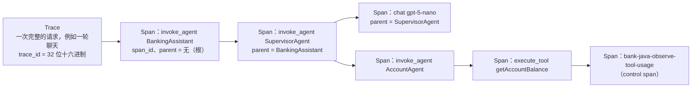

# Galileo Java 插桩教程（写给不熟悉 Java 的读者）

目标：读完本文，你能看懂本项目是**在哪里、用什么方式**给 Java 代码加上 OpenTelemetry（OTel）观测和 Agent Control 门禁的，能自己运行一次并在 Splunk AO Console 中找到对应的 Trace。所有代码片段都摘自最终能编译、测试通过的源码。

## 1. 先认识几个 Java 概念

| 概念 | 一句话解释 | 在本项目中的例子 |
|---|---|---|
| class（类） | 代码和数据的模板 | `ChatService` 处理一轮聊天 |
| interface（接口） | 只规定“能做什么”，不规定“怎么做”；可以有多种实现 | `ControlGateway` 有 `RemoteAgentControlGateway`（真的调服务）和 `NoOpControlGateway`（关闭时什么也不做）两种实现 |
| Spring Bean | 由 Spring 框架创建并管理的对象，整个应用通常只有一个 | 带 `@Component`、`@Configuration` 的类，或 `@Bean` 方法返回的对象 |
| 构造器依赖注入 | 一个类需要别的对象时，把它们写在构造器参数里，Spring 自动传入 | `SupervisorAgent(IntentRouter router, DomainAgentGateway gateway, AgentSpanRunner spans)` |
| 注解（annotation） | 以 `@` 开头的标记，让框架知道如何处理这段代码 | `@Tool` 告诉 LangChain4j“这个方法可以给模型调用”；`@PostMapping` 声明 HTTP 接口 |
| Lambda | 可以当参数传递的一小段代码 | `memoryId -> prompts.systemPrompt(agent)` |
| `try-with-resources` | `try (X x = ...) { }` 结束时**一定**会自动调用 `x.close()`，即使中途出错 | `try (Scope ignored = span.makeCurrent()) { ... }` 保证“当前 Span”一定被恢复 |
| 异常（exception） | 出错时抛出、由上层 `catch` 处理的对象 | `ControlDeniedException`：Control 拒绝时抛出 |
| `finally` | 无论成功或失败都会执行的代码块 | `span.end()` 放在 `finally` 里，Span 一定会结束 |
| ThreadLocal | 每个线程各自一份的变量 | 应用原有的 `ExecutionTrace`（右侧“执行详情”面板的数据）存在 ThreadLocal 中 |
| OTel Context | OTel 用来记住“当前是哪个 Span”的上下文，也绑定在当前线程上，但可以显式传递 | `span.makeCurrent()` 把 Span 设为当前；之后创建的 Span 自动以它为父 |

ThreadLocal 与 OTel Context 的区别：前者是本项目自己的业务记录，只服务于 UI；后者是 OTel 的标准机制，决定 Span 的父子关系并随 Trace 发往 AO。两者并存，互不替代。

## 2. OTel 的四个核心对象



- **Trace**：一次请求的全部步骤，所有 Span 共享同一个 `trace_id`。
- **Span**：一个步骤，有开始/结束时间、名称、属性（attributes）、状态，以及父 Span 的 `span_id`。
- **Scope**：`span.makeCurrent()` 返回的对象，表示“在这段代码里，这个 Span 是当前 Span”；关闭 Scope 就恢复原来的当前 Span。
- **Exporter**：把结束的 Span 发出去。本项目用 OTLP/HTTP Exporter 发到 Splunk AO；测试中用 `InMemorySpanExporter` 收集在内存里检查。

**自动插桩 vs 手工插桩**：OTel Java Agent（`-javaagent:…`）可以在不改代码的情况下记录 HTTP、JDBC 等通用调用，但它不知道“哪个是 Supervisor、哪个是 Agent、哪个是 Tool”，也无法在 Tool 执行**前**做 Control 门禁。因此本项目使用**手工插桩**：在业务边界处用 OTel API 显式创建 Span。

## 3. 依赖与 SDK 配置

`pom.xml`（版本 1.49.0 由 Spring Boot 3.5.16 的 BOM 统一管理，无需写版本号）：

```xml
<dependency>
    <groupId>io.opentelemetry</groupId>
    <artifactId>opentelemetry-api</artifactId>
</dependency>
<dependency>
    <groupId>io.opentelemetry</groupId>
    <artifactId>opentelemetry-sdk</artifactId>
</dependency>
<dependency>
    <groupId>io.opentelemetry</groupId>
    <artifactId>opentelemetry-exporter-otlp</artifactId>
    <exclusions>
        <exclusion>
            <groupId>io.opentelemetry</groupId>
            <artifactId>opentelemetry-exporter-sender-okhttp</artifactId>
        </exclusion>
    </exclusions>
</dependency>
<dependency>
    <groupId>io.opentelemetry</groupId>
    <artifactId>opentelemetry-exporter-sender-jdk</artifactId>
</dependency>
<!-- 测试：InMemorySpanExporter -->
<dependency>
    <groupId>io.opentelemetry</groupId>
    <artifactId>opentelemetry-sdk-testing</artifactId>
    <scope>test</scope>
</dependency>
```

用 JDK 自带的 HTTP 发送器替换 OkHttp：少引入一批依赖，并且和 OpenAI 调用共用 `scripts/run.sh` 生成的项目专用 truststore（公司 TLS 检查环境必需）。

SDK 在 `observability/OtelConfiguration.java` 中创建（节选）：

```java
OtlpHttpSpanExporter otlp = OtlpHttpSpanExporter.builder()
        .setEndpoint(settings.otlpEndpoint().value())          // https://ingest.<realm>…/v2/trace/otlp
        .setTimeout(tuning.exportTimeout())
        .addHeader(settings.otlpAuthHeader().value(), settings.otlpAuthValue().value())  // X-SF-Token
        .addHeader("project", project)                           // 按名称路由到 Project
        .addHeader("logstream", stream)                          // 按名称路由到 Agent Stream
        .build();
Resource resource = Resource.getDefault().merge(Resource.create(Attributes.builder()
        .put("service.name", settings.serviceName().value())
        .put(settings.projectRoutingAttribute(), project)        // splunk_ao.project.name
        .put(settings.streamRoutingAttribute(), stream)          // splunk_ao.logstream.name
        .build()));
SdkTracerProvider provider = SdkTracerProvider.builder()
        .setResource(resource)
        .addSpanProcessor(BatchSpanProcessor.builder(new BankTelemetry.StatsSpanExporter(otlp, stats))
                .setScheduleDelay(tuning.batchScheduleDelay())   // 默认 2 秒批量发送，不阻塞业务请求
                .build())
        .build();
```

`OBSERVABILITY_ENABLED=false` 时不创建 SDK，`BankTelemetry.noop()` 返回一个什么也不做的 Tracer：所有插桩代码照常运行，但不产生任何 Span、不发任何网络请求，行为与没有插桩时完全一致（`ControlDisabledRegressionIT` 验证）。

## 4. 插桩的通用写法

所有 Agent Span 都由 `observability/AgentSpanRunner.java` 创建，写法固定为四步：

```java
Span span = spans.startAgent("SupervisorAgent", conversationId, message);   // 1. 在执行前创建 Span
try (Scope ignored = span.makeCurrent()) {                                   // 2. 设为当前 Span
    SupervisorResult result = route(...);                                    //    内部创建的 Span 自动成为子 Span
    spans.setOutput(span, result.answer());
    return result;
} catch (RuntimeException e) {
    AgentSpanRunner.recordFailure(span, e);                                  // 3. 记录失败（error.type + ERROR 状态）
    throw e;
} finally {
    span.end();                                                              // 4. 一定结束 Span
}
```

`recordFailure` 刻意**不调用** `span.recordException(e)`：那会把完整堆栈（可能包含输入内容）导出到 AO。这里只导出错误码和经过遮蔽的简短说明。

## 5. 真实类的“修改前 / 修改后”

### 5.1 `conversation/ChatService.java`：一轮聊天的根 Span

修改前（插桩前）：

```java
ExecutionTrace trace = ExecutionTrace.begin(conversation.getId());
trace.setUserMessage(message);
try {
    List<Conversation.Turn> history = conversation.recentTurns(...);
    SupervisorAgent.SupervisorResult result = supervisor.handle(conversation.getId(), message, history);
    conversationService.recordUserMessage(conversation, message);
    conversationService.recordAssistantMessage(conversation, result.answer());
    ...
} finally {
    ExecutionTrace.end();
    conversation.lock().unlock();
}
```

修改后（插桩后）：

```java
ExecutionTrace trace = ExecutionTrace.begin(conversation.getId());
trace.setUserMessage(message);
Span root = spans.startAgent(ROOT_AGENT, conversation.getId(), message);       // + 根 Span：invoke_agent BankingAssistant
try (Scope ignored = root.makeCurrent()) {
    trace.setTraceId(AgentSpanRunner.currentTraceId());                        // + 把 trace_id 返回给 UI/API
    List<Conversation.Turn> history = conversation.recentTurns(...);
    Turn turn = governedTurn(conversation.getId(), message, history);         // + PRE Control → Supervisor → POST Control
    conversationService.recordUserMessage(conversation, turn.inputWithheld() ? WITHHELD_USER_MESSAGE : message);
    conversationService.recordAssistantMessage(conversation, turn.answer());
    root.setAttribute(GenAiAttributes.BANK_INTENT, turn.intent());
    spans.setOutput(root, turn.answer());
    ...
} catch (RuntimeException e) {
    AgentSpanRunner.recordFailure(root, e);
    throw e;
} finally {
    root.end();
    ExecutionTrace.end();
    conversation.lock().unlock();
}
```

`gen_ai.conversation.id` 设为会话 ID，AO 据此把同一会话的多轮 Trace 归入同一个 Session。

### 5.2 `agent/SupervisorAgent.java` 与 `agent/LangChainDomainAgentGateway.java`：Agent Span

Supervisor 的 `handle(...)` 被包进 `invoke_agent SupervisorAgent`（写法同第 4 节）。领域 Agent 的委派修改如下：

```java
// 修改前
try {
    return switch (agent) {
        case ACCOUNT -> accountAgent.chat(conversationId, task);
        ...
    };
} catch (RuntimeException e) {
    throw LlmErrorTranslator.translate(e);
} finally { ... }

// 修改后
Span span = spans.startAgent(spanAgentName(agent), conversationId, task);   // invoke_agent AccountAgent
try (Scope ignored = span.makeCurrent()) {
    String answer = switch (agent) {
        case ACCOUNT -> accountAgent.chat(conversationId, task);           // 其中的 LLM / Tool Span 成为子 Span
        ...
    };
    spans.setOutput(span, answer);
    return answer;
} catch (RuntimeException e) {
    RuntimeException translated = LlmErrorTranslator.translate(e);
    AgentSpanRunner.recordFailure(span, translated);
    throw translated;
} finally {
    span.end();
    ...
}
```

### 5.3 LLM 调用：为什么不用 `TraceChatModelListener`

应用原有的 `llm/TraceChatModelListener.java`（只改了类注释）实现了 LangChain4j 的 `ChatModelListener`，它的 `onResponse` 在模型**返回之后**才被调用。它适合给 UI 记录 token 和耗时，但不适合做 Span：

- Span 需要在调用**开始前**创建并设为当前，才能拥有正确的开始时间和父子关系；
- PRE Control 必须在请求发给 OpenAI **之前**执行，监听器做不到“阻止调用”。

因此新增装饰器 `governance/GovernedChatModel.java`：它实现与真实模型相同的 `ChatModel` 接口，包住真实的 OpenAI 模型，只覆盖 `doChat(...)`：

```java
// agent/AgentConfig.java —— 修改前
return AiServices.builder(type)
        .chatModel(chatModel)
        .tools(tools)
        ...
// 修改后：模型和工具都“包一层”，其余配置不变
return AiServices.builder(type)
        .chatModel(governance.governChatModel(chatModel, StepCatalog.agentStep(agent)))
        .tools(governance.governTools(tools))
        ...
```

`GovernedChatModel.doChat` 在每次真实模型调用前创建 `chat <model>` Span（`SpanKind.CLIENT`），执行 PRE Control，调用真实模型，记录 `gen_ai.usage.input_tokens/output_tokens`、`gen_ai.response.model`、`finish_reasons`，再执行 POST Control。真实模型自己的监听器（`TraceChatModelListener`）照常触发，UI 数据不受影响；装饰器的 `listeners()` 返回空列表，避免同一监听器被触发两次。Supervisor 的路由模型（`LlmIntentRouter`）也用同样方式包装，步骤名 `supervisor-router`。

### 5.4 只读 Tool：`tool/AccountTools.getAccountBalance`

**Tool 类本身没有任何修改**：

```java
@Tool(name = "getAccountBalance", value = "Get the current balance and currency of the customer's demo account(s).")
public String getAccountBalance(@ToolMemoryId String conversationId,
                                @P(value = "Which account: CHECKING (活期, default), SAVINGS (储蓄) or ALL", required = false)
                                String accountType) {
    ...
}
```

`@Tool` 只是告诉 LangChain4j“这个方法可以给模型调用”，它**不是** OTel 插桩，也不会产生任何 Span。插桩由 `governance/StepGovernance.governTools(...)` 完成：它为每个 `@Tool` 方法构造 LangChain4j 的默认执行器，再用 `GovernedToolExecutor` 包一层：

```java
// governance/GovernedToolExecutor.executeWithContext（节选）
Span span = tracer.spanBuilder("execute_tool " + toolName) ... .startSpan();
try (Scope ignored = span.makeCurrent()) {
    ControlOutcome pre = runner.check(ControlStage.PRE, step);           // ① PRE：方法执行前
    switch (pre.verdict()) {
        case DENY: return blocked(span, "CONTROL_DENIED", "... The tool was NOT executed ...", pre);
        case STEER: ...
        case BLOCKED_UNAVAILABLE: return blocked(span, "CONTROL_UNAVAILABLE", ..., pre);
        default: break;
    }
    ToolExecutionResult result = delegate.executeWithContext(request, context);   // ② 真正的 Java 方法
    ...
    ControlOutcome post = runner.check(ControlStage.POST, step.withOutput(parse(text)));   // ③ POST：结果交给模型前
    ...
} finally {
    span.end();
}
```

为什么不能用应用原有的 `afterToolExecution` 回调做 Control：它在 Tool **执行完成之后**才被调用，此时转账草稿已经写入数据库，无法实现 PRE 阻止。`afterToolExecution` 继续用于 UI 的执行详情记录。

### 5.5 写 Tool：`tool/PaymentTools.createTransferDraft`

同样**没有修改 Tool 方法**，它走与 5.4 相同的 `GovernedToolExecutor`。区别在于它被 `StepCatalog` 标记为写步骤：

- PRE 不可用时默认 **fail-closed**，方法不执行，不产生草稿；
- PRE STEER 时本轮锁定该 Tool，要求用户自己修改请求，模型不能自行改金额或收款人；
- POST 被 DENY / STEER / 不可用时，`tool/TransferToolSideEffects.java` 把刚创建的草稿撤回（`PaymentService.withdrawByControl`，状态 CANCELLED，审计码 `CONTROL_WITHDRAWN`），UI 卡片显示“已撤回，未扣款”。

### 5.6 UI 确认：`api/PaymentController.confirm`

修改前：

```java
public ConfirmationResult confirm(@PathVariable String draftId, @Valid @RequestBody DraftActionRequest request) {
    requireValidId(draftId);
    String conversationId = request.conversationId();
    String customerId = conversationService.requireCustomerId(conversationId);
    try {
        ConfirmationResult result = paymentService.confirm(draftId, conversationId, customerId);
        ...
        return result;
    } catch (BankingException e) { ... throw e; }
}
```

修改后（节选）：

```java
public ConfirmationResult confirm(@PathVariable String draftId, @Valid @RequestBody DraftActionRequest request,
                                  HttpServletResponse response) {
    Span span = businessSpan(StepCatalog.PAYMENT_CONFIRM, "confirm", draftId, request.conversationId());
    try (Scope ignored = span.makeCurrent()) {
        traceHeaders(span, response, "confirm");                       // X-Bank-Trace-Id / X-Bank-AO-Trace-Id
        ...
        ControlStep step = confirmStep(draftId, conversationId, customerId);
        if (step != null) {
            enforcePreConfirm(step, draftId, conversationId, customerId); // DENY→403、STEER→409、不可用→503，均在扣款前
        }
        ConfirmationResult result = paymentService.confirm(draftId, conversationId, customerId);   // 扣款（原逻辑不变）
        ...
        if (step != null) {
            control.check(ControlStage.POST, step.withOutput(output));   // 只审计，扣款不会被“撤销”
        }
        return result;
    } catch (RuntimeException e) {
        AgentSpanRunner.recordFailure(span, e);
        throw e;
    } finally {
        span.end();
    }
}
```

`payment.confirm` 是一个**新的根 Span**（`setNoParent()`），因为用户点击按钮是一次独立的请求，不应伪装成之前聊天回合的子步骤。它通过 Span **link** 指向创建草稿的那个 Tool Span，并带有相同的 `gen_ai.conversation.id`，因此在 AO 中与聊天位于同一个 Session（[`VALIDATION.md`](VALIDATION.md) 截图 3）。

## 6. 本地验证 Span 结构（不联网）

`OtelSpanStructureIT` 用 `InMemorySpanExporter` 替代 OTLP Exporter，检查真实请求路径产生的 Span：

```java
model.routeTo("ACCOUNT", "查询活期余额")                         // 脚本化的模型（不调用 OpenAI）
        .toolCall("getAccountBalance", "{\"accountType\":\"CHECKING\"}")
        .answer("您的活期账户余额为 52,368.50 元。");
ChatService.ChatTurnResult result = chatService.chat(null, "我现在的活期账户余额是多少？");   // 真实的 Java 调用链

List<SpanData> all = spans.getFinishedSpanItems();
SpanData root = one(all, "invoke_agent BankingAssistant");
SpanData tool = one(all, "execute_tool getAccountBalance");
assertThat(root.getParentSpanId()).isEqualTo(SpanId.getInvalid());
assertThat(all).allSatisfy(s -> assertThat(s.getTraceId()).isEqualTo(root.getTraceId()));
// 其余断言：父子关系、gen_ai.* 属性、token、默认不导出正文、错误状态、不同会话不共享 trace_id …
```

```bash
./mvnw -B -Dit.test=OtelSpanStructureIT -Dtest=none -Dsurefire.failIfNoSpecifiedTests=false verify
```

## 7. 在真实 AO 中查看

```bash
scripts/run.sh --background --observe            # 只开 Observe
scripts/galileo-smoke.sh --yes                   # 问 3 个只读问题，约 1 分钟后在终端回读 Span 树（真实 OpenAI，少量费用）
scripts/galileo-smoke.sh --trace <traceId>       # 只读：回读任意一条已有 Trace，并打印它所属的 AO Session
```

`/api/chat` 的响应和 UI 右侧“执行详情”都会显示 `traceId`（OTel）与 `aoTraceId`（AO UUID）。在 Console 中：

1. 打开 Project `bank-agent-java` → Agent Stream `bank-java-demo` → **Tracing**（`/api/status` 中的 `consoleStreamUrl` 可直接打开）；
2. 在 **Sessions** 视图中，最新的会话就是刚才的对话；**Traces** 视图按时间列出 Trace，External Id 列就是 UI 显示的 `traceId`；
3. 进入 Trace 后的 **Messages** 视图显示父子树：根 `invoke_agent BankingAssistant` → `invoke_agent SupervisorAgent` → `chat gpt-5-nano`（路由）→ `invoke_agent AccountAgent` → `chat` / `execute_tool …` → 盾牌图标的 control span；
4. 选中 LLM span，右侧 **System Metrics** 显示 Num Input/Output Tokens、Latency、Cost；
5. 失败步骤的 span metadata 中有 `error.type` 与 `otel.status_code: ERROR`（AO 目前不把它映射为记录的状态码，见 [`VALIDATION.md`](VALIDATION.md) K2）。

演示时如何快速定位某一条 Trace（包括直接打开 Trace 的链接格式），见 [`../demo/DEMO-GUIDE.md`](../demo/DEMO-GUIDE.md)。

## 8. 出站请求与安全

| 出站目标 | 何时 | 内容 |
|---|---|---|
| `api.openai.com` | 每次 LLM 调用（应用本身就有） | 提示词、虚构的银行数据 |
| `ingest.<realm>.observability.splunkcloud.com`（OTLP） | `OBSERVABILITY_ENABLED=true` | Span 结构、耗时、token、模型名、步骤名；**默认不含正文**（`[omitted: DEMO_TRACE_CONTENT=false]`），工具参数只导出参数名、结果只导出长度 |
| `app.<realm>.observability.splunkcloud.com/ao/api` | Observe 或 Control 开启时启动一次 | 按名称查找/创建 Project 与 Agent Stream |
| `app.<realm>.observability.splunkcloud.com/ao/agent-control` | `CONTROL_MODE=remote-api` | 受控步骤的输入/输出（评估必需，Control 不能在没有内容的情况下判断）；会话 ID |

- 凭据只来自仓库外的 `~/.config/bank-agent-java/galileo.properties`（0600）或环境变量；日志和 `/api/status` 只显示 `<set>` / `<missing>`。
- 即使开启 `DEMO_TRACE_CONTENT=true`，导出内容也会经过 `TraceContentPolicy`：遮蔽密钥模式和长数字串，并截断到 2000 字符。
- 不使用 `recordException`，不导出堆栈；从不打印 HTTP 头（OTel 的 HTTP 日志级别固定为 WARN）。
- 所有 TLS 校验保持开启；公司 TLS 检查环境使用项目专用 truststore，而不是信任所有证书。
